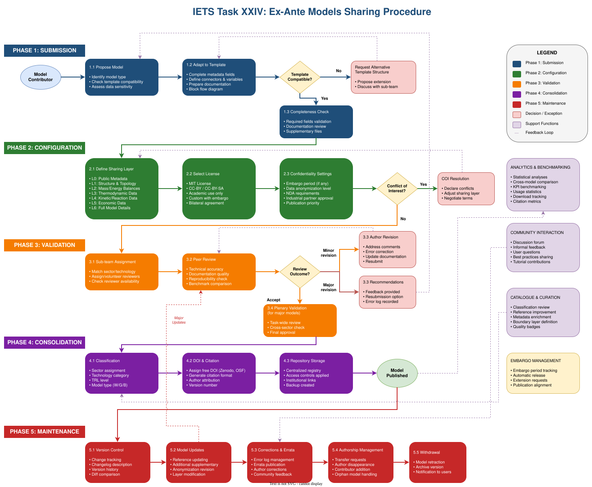

# How to use and contribute to this database {.unnumbered}

## Browsing the models {.unnumbered}

Models are grouped in three sections: **Energy technologies**, **Decarbonization technologies** and **Industrial processes**, each divided into categories (for example *Power and utilities* or *Petrochemical*). Each category page lists its models and whether they are documented yet, and each model has one page. Its tables, equations and plots are generated from the model's JSON description, so they always match the data:

* a **model card** with the metadata of the template (authors, version, status, confidentiality and sharing layer, grade, reference capacity, TRL, keywords, main publication);
* a description of the technology or process and its block flow diagram;
* the **key figures** — minimum hot and cold utility, internal heat recovery, pinch — and the **flows** entering and leaving the model, with its heat demand and heat release. A scale factor *f* rescales every duty and flow on the page;
* the model **equations**, one per calculated variable, and the tables of input and calculated **variables**;
* the **unit and connectors**, equipment and operating costs;
* the **heat streams** table (hot streams in red, cold streams in blue), the **composite curves** and the **grand composite curve**;
* links to the **supplementary material**: the OSMOSE (Lua) implementation, the JSON and Excel descriptions, documents and editable figures.

**Variables are linked everywhere.** A variable name in the text (written like `Cool_Qmax`), a symbol in an equation, or an underlined value in a table shows the variable's definition when you hover over it — symbol, value, range, formula, description and source — and takes you to its row in the variables table when you click it. Hovering a point of a plot shows its values.

The search box at the bottom of the sidebar searches the full text of every page.

## Getting the repository {.unnumbered}

The database is a [Quarto](https://quarto.org/) website kept in a git repository. Task participants are given access by the Task managers. To work on it locally, you need:

* [Git](https://git-scm.com/);
* [Quarto](https://quarto.org/docs/get-started/);
* optionally, [Visual Studio Code](https://code.visualstudio.com/) with the *Quarto* extension, which provides syntax highlighting, a preview button and git integration.

Clone the repository and preview the site:

```bash
git clone git@github.com:dflorez0/IETSTaskXXIVbyIEA.git
cd IETSTaskXXIVbyIEA
quarto preview
```

`quarto preview` serves the site in your browser and reloads it every time a file is saved. `quarto render` builds the complete site into `_book/`. The website itself is rebuilt and published automatically every time changes are pushed to the `main` branch.

## Submitting and publishing a model {.unnumbered}

Models are shared following the procedure of @fig-sharing-procedure, in five phases: the contributor proposes the model and adapts it to the template (submission); chooses its sharing layer, licence and confidentiality settings (configuration); a sub-team reviews it, possibly followed by a plenary validation (validation); it is classified, given a DOI and stored in the repository (consolidation); and its versions, corrections, authorship and possible withdrawal are then managed over time (maintenance). To submit a model, write to the [contact for model submissions](06-ContactModelSubmissions.qmd).

{#fig-sharing-procedure .lightbox width=100%}

The steps below add a model to the repository and publish its page. The [Cooling tower](1-EnergyTechnologies/PowerAndUtilities/CoolingTower/index.qmd) is a complete example to copy from.

**1. Create the model folder** in the folder of its category, named after the model:

```
1-EnergyTechnologies/
  PowerAndUtilities/   the category
    index.qmd          the category page, listing its models
    CoolingTower/
      index.qmd        the model page
      JSON/            model description in the Task XXIV template format
      Osmoses/         OSMOSE (Lua) implementation, or the files of your own software
      Excel/           Excel version of the template
      Documents/       background documents
      Figures/         block flow diagram (.svg) and its editable source
      Literature/      publications used by the model
```

Only `index.qmd` and the JSON description are required; the other folders hold whatever supplementary material the model has.

**2. Fill in the template.** Document the model with the ex-ante model template described in the [rules for participating and sharing models](01-ParticipationRules.qmd): metadata, variables, and for each unit its connectors, heat streams, equipment and operating costs. Export it as JSON into the `JSON/` folder. Choose the sharing layer that matches what you are allowed to disclose.

**3. Write the model page** `index.qmd`, starting with a level-1 title:

```markdown
# Cooling tower {.unnumbered}
```

followed by the model card, a description, the block flow diagram, the model equations and parameters, and a table linking every supplementary file, for example:

```markdown
| [CoolingTower.json](JSON/CoolingTower.json) | Model description in the Task XXIV JSON format |
```

Files linked from the page are published with it, so readers can download them.

**4. Add the generated views.** Each view is one line that renders part of the model from its JSON description; place them in the sections of the page where they belong:

```markdown
{}
```

| View | Renders |
|:--|:--|
| `card` | Model card from the metadata |
| `summary` | Key figures, with the unit selector and the scale factor *f* |
| `flows` | Flows in and out of the unit, heat demand and heat release |
| `equations` | One equation per calculated variable, from its formula |
| `variables` | Tables of input and calculated variables |
| `unit` | Unit description, connectors, equipment and operating costs |
| `streams` | Heat streams table and data checks |
| `cc` | Composite curves |
| `gcc` | Grand composite curve |
| `references` | References listed in the metadata |

: Views of the `model-viewer` shortcode {.striped}

Without `view`, the shortcode renders a compact tabbed overview of the key figures, flows, heat streams and curves. The [cooling tower page](1-EnergyTechnologies/PowerAndUtilities/CoolingTower/index.qmd) uses every view and can serve as a template.

When the text names a variable, write it as inline code with its exact name in the JSON — `` `Cool_Qmax` `` — and it becomes linked automatically.

The labels of an SVG diagram can be linked too. Write the variable names in the diagram, next to the part they describe (for example `H2_input` under the hydrogen feed), and add `mv-src` with the JSON file to the figure:

```markdown
{#fig-methanation mv-src="JSON/Methanation.json"}
```

Every label that is exactly a variable name then links to that variable. Name only the parts whose variable is certain.

The views also run data checks and list them where they apply: a stream declared *Hot* whose temperature rises, a heat stream without a ΔT~min~ contribution, a connector without a flow, or a calculated value that differs from what its formula gives with the stored values of its variables. They are a quick way to validate a JSON file.

**5. Register the page** in `_quarto.yml`, under `website: sidebar: contents:`, in the contents of its category. A category with model pages is a section within its section:

```yaml
      - section: "Energy technologies"
        href: 1-EnergyTechnologies/index.qmd
        contents:
          - section: "Power and utilities"
            href: 1-EnergyTechnologies/PowerAndUtilities/index.qmd
            contents:
              - 1-EnergyTechnologies/PowerAndUtilities/CoolingTower/index.qmd
```

A category without model pages yet is listed as a plain page (`- 1-EnergyTechnologies/Renewables/index.qmd`); turn it into a `section:` as above when its first model is added. The name shown in the sidebar for a section (`"Power and utilities"`) is written here; a page is listed under its title.

Then, in the table of the category page, link the model in the *Model* column of its row, and set its *Status* to `Documented` once the page documents the model (`Work in progress` until then). The overview table of the section page is computed from the category pages at every render, so it needs no editing.

**6. Preview, commit and push.** Check the page with `quarto preview`, then commit your changes and push them:

```bash
git add 1-EnergyTechnologies/PowerAndUtilities _quarto.yml
git commit -m "Add cooling tower model"
git push
```

Every change is recorded in the repository history with its author, date and description, which keeps track of the provenance of each model. A few minutes after the push, the new page is online; the repository's *Actions* tab shows the progress of the build.

## Writing with Quarto {.unnumbered}

Model pages are written in Markdown, with LaTeX equations, cross-referenced figures and tables, and citations. The [Quarto guide](https://quarto.org/docs/guide/) covers the syntax, and [cross-references](https://quarto.org/docs/authoring/cross-references.html) explains how to number and reference equations, figures and tables.
