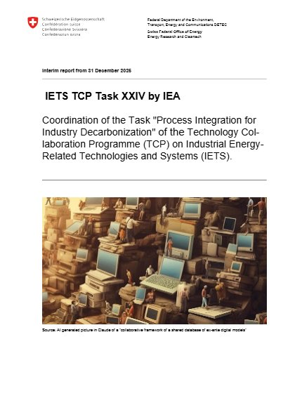

# Annual Interim Task Report to SFOE {.unnumbered}

The coordination of Task XXIV is funded by the Swiss Federal Office of Energy (SFOE), to which the Task managers report every year. The interim report of 31 December 2025 documents the first year of the Task.

```{=html}
<div class="report-card">
  <a class="report-cover" href="0-TaskXXIVDescription/IETS-TaskXXIV-Interim-Report-2025.pdf" target="_blank" rel="noopener" title="Open the report (PDF)">
    
  </a>
  <div class="report-info">
    <p class="report-kicker">Interim report · 31 December 2025</p>
    <p class="report-title">IETS TCP Task XXIV by IEA</p>
    <p class="report-subtitle">Coordination of the Task “Process Integration for Industry Decarbonization” of the Technology Collaboration Programme (TCP) on Industrial Energy-Related Technologies and Systems (IETS)</p>
    <p class="report-authors">Daniel Flórez-Orrego, Oktay Boztas, Meire Ribeiro Domingos, Pullah Bhatnagar, François Maréchal · EPFL</p>
    <p class="report-actions">
      <a class="btn btn-primary" href="0-TaskXXIVDescription/IETS-TaskXXIV-Interim-Report-2025.pdf" target="_blank" rel="noopener"><i class="bi bi-file-earmark-pdf" aria-hidden="true"></i> Open the report</a>
      <a class="btn btn-outline-secondary" href="0-TaskXXIVDescription/IETS-TaskXXIV-Interim-Report-2025.pdf" download="IETS-TaskXXIV-Interim-Report-2025.pdf"><i class="bi bi-download" aria-hidden="true"></i> Download (PDF, 6.4 MB)</a>
    </p>
  </div>
</div>
```

## Bibliographic information {.unnumbered}

| | |
|:------|:------------------|
| **Title** | IETS TCP Task XXIV by IEA: Coordination of the Task "Process Integration for Industry Decarbonization" of the Technology Collaboration Programme (TCP) on Industrial Energy-Related Technologies and Systems (IETS) |
| **Type** | Interim report from 31 December 2025 |
| **Authors** | Daniel Flórez-Orrego (Task co-manager), Oktay Boztas, Meire Ribeiro Domingos, Pullah Bhatnagar and François Maréchal (Task co-manager), EPFL |
| **Publisher** | Swiss Federal Office of Energy SFOE, Energy Research and Cleantech, CH-3003 Berne |
| **Subsidy recipient** | École Polytechnique Fédérale de Lausanne (EPFL), Sion |
| **SFOE project coordinator** | Elena-Lavinia Niederhaeuser |
| **SFOE contract number** | SI/502966-01 |
| **Scope** | Task XXIV "Process integration for industry decarbonization", Subtask 1 "Enabling a shared database of ex-ante models of industrial processes, decarbonization technologies and energy systems featuring sustainability metrics" |
| **Language** | English, with summaries in German and French |
| **Length** | 76 pages |

: {.striped}

**Suggested citation.** Flórez-Orrego D., Boztas O., Ribeiro Domingos M., Bhatnagar P., Maréchal F. (2025). *IETS TCP Task XXIV by IEA: Coordination of the Task "Process Integration for Industry Decarbonization" of the Technology Collaboration Programme (TCP) on Industrial Energy-Related Technologies and Systems (IETS).* Interim report, 31 December 2025. Swiss Federal Office of Energy SFOE, Berne. SFOE contract SI/502966-01.

## Summary {.unnumbered}

In its first year, the coordination of Task XXIV engaged representatives of ten participating countries and three observer countries through plenary and bilateral meetings, a participants' survey and a first in-person meeting in Lisbon. It delivered deliverable D1: a simplified, software-agnostic template of ex-ante models, organized as a class-attribute tree, that accommodates black-, grey- and white-box models, together with the procedures for sharing them. The survey identified confidential industrial data as the main barrier to sharing models and shaped the seven-tier disclosure framework: layers 0 to 2 are public, layers 3 and 4 are shared case by case, and layers 5 and 6 require bilateral agreements. The report also reviews existing ontologies and interoperability standards, and documents the dissemination of the Task at ESCAPE, EUBCE and IBBCE 2025. The second year focuses on the documentation tool (D2) and on populating the database (D3).

## Contents {.unnumbered}

Each entry opens the report at its first page.

* [Summary](0-TaskXXIVDescription/IETS-TaskXXIV-Interim-Report-2025.pdf#page=4){target="_blank"}, with its [German](0-TaskXXIVDescription/IETS-TaskXXIV-Interim-Report-2025.pdf#page=5){target="_blank"} and [French](0-TaskXXIVDescription/IETS-TaskXXIV-Interim-Report-2025.pdf#page=6){target="_blank"} versions
* [1. Introduction](0-TaskXXIVDescription/IETS-TaskXXIV-Interim-Report-2025.pdf#page=16){target="_blank"}: context, structure and objectives of the Task
* [2. Approach, method, results and discussion](0-TaskXXIVDescription/IETS-TaskXXIV-Interim-Report-2025.pdf#page=20){target="_blank"}: the model template, the [key results of 2025](0-TaskXXIVDescription/IETS-TaskXXIV-Interim-Report-2025.pdf#page=22){target="_blank"}, the status of the deliverables, and the [meetings and participants' survey](0-TaskXXIVDescription/IETS-TaskXXIV-Interim-Report-2025.pdf#page=25){target="_blank"}
* [3. Conclusions and outlook](0-TaskXXIVDescription/IETS-TaskXXIV-Interim-Report-2025.pdf#page=29){target="_blank"}
* [4. National and international cooperation](0-TaskXXIVDescription/IETS-TaskXXIV-Interim-Report-2025.pdf#page=30){target="_blank"}, with the participants of the Task
* [5. Publications and other communications](0-TaskXXIVDescription/IETS-TaskXXIV-Interim-Report-2025.pdf#page=37){target="_blank"}
* [6. References](0-TaskXXIVDescription/IETS-TaskXXIV-Interim-Report-2025.pdf#page=47){target="_blank"}
* Appendices: [A. Review of ontologies and interoperability standards](0-TaskXXIVDescription/IETS-TaskXXIV-Interim-Report-2025.pdf#page=51){target="_blank"}; [B. Ex-ante model template: formulation, structure and planned extensions](0-TaskXXIVDescription/IETS-TaskXXIV-Interim-Report-2025.pdf#page=54){target="_blank"}; [C. Coordination meetings and participants' survey](0-TaskXXIVDescription/IETS-TaskXXIV-Interim-Report-2025.pdf#page=63){target="_blank"}

## The report {.unnumbered}

```{=html}
<div class="report-viewer">
  <object data="0-TaskXXIVDescription/IETS-TaskXXIV-Interim-Report-2025.pdf#view=FitH" type="application/pdf" aria-label="Interim report of 31 December 2025 (PDF)">
    <p>This browser cannot show the report here: <a href="0-TaskXXIVDescription/IETS-TaskXXIV-Interim-Report-2025.pdf">open it as a PDF</a>.</p>
  </object>
</div>
<p class="report-viewer-phone">On a phone, the report opens in the PDF viewer of the device:
  <a class="btn btn-primary btn-sm" href="0-TaskXXIVDescription/IETS-TaskXXIV-Interim-Report-2025.pdf" target="_blank" rel="noopener"><i class="bi bi-file-earmark-pdf" aria-hidden="true"></i> Open the report</a></p>
```
