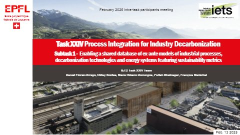
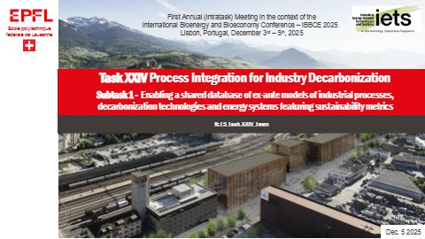
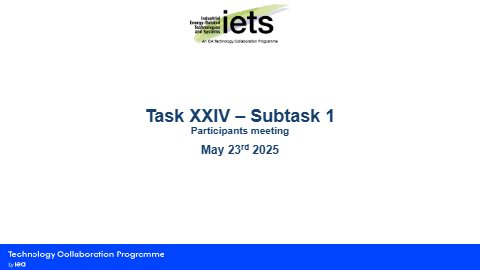
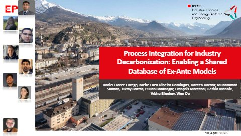
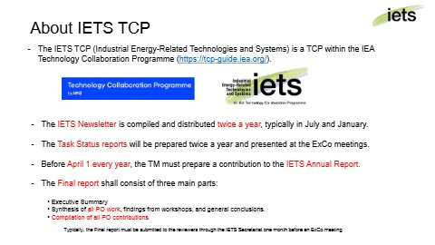

# Intra-task presentations {.unnumbered}

<!--
  One block per meeting, newest first: a level-3 heading with the meeting and its date, then a
  slides card. The PDF and its first slide (a 480 px wide JPEG) go to
  0-TaskXXIVDescription/presentations/, named after the date of the meeting. Leave out the slides
  that list the participants' email addresses and the links to internal documents or recordings.
-->

The slides presented by the Task managers at the meetings of the Task participants. Each presentation can be opened as a PDF, downloaded, or shown on this page; recordings of the meetings are on the [Task XXIV playlist on YouTube](https://www.youtube.com/playlist?list=PLpiTZx5_rPlCT_1Pb3Zh1TYdmAYYGTFZP). In accordance with personal data protection, the published slides omit the participants' personal data, such as their email addresses.

## 2026 {.unnumbered}

### Participants' meeting, 13 February 2026 {.unnumbered}

```{=html}
<div class="slides-card">
  <a class="slides-thumb" href="0-TaskXXIVDescription/presentations/2026-02-13-participants-meeting-first-year-recap.pdf" target="_blank" rel="noopener" title="Open the slides (PDF)">
    
  </a>
  <div class="slides-info">
    <p class="slides-title">Subtask 1: recap of the first year</p>
    <p>The first year of the Task and the plan for 2026: the redefinition of the ex-ante model template, the rules of the game, the database infrastructure, the annual reports of 2025, the LinkedIn page, the IETS website and forum, and the next steps.</p>
    <p class="slides-actions">
      <a class="btn btn-primary btn-sm" href="0-TaskXXIVDescription/presentations/2026-02-13-participants-meeting-first-year-recap.pdf" target="_blank" rel="noopener"><i class="bi bi-file-earmark-pdf" aria-hidden="true"></i> Open the slides</a>
      <a class="btn btn-outline-secondary btn-sm" href="0-TaskXXIVDescription/presentations/2026-02-13-participants-meeting-first-year-recap.pdf" download><i class="bi bi-download" aria-hidden="true"></i> Download (PDF, 61 slides, 9.5 MB)</a>
    </p>
  </div>
  <details class="slides-viewer" data-pdf="0-TaskXXIVDescription/presentations/2026-02-13-participants-meeting-first-year-recap.pdf"><summary>Show the slides on this page</summary></details>
</div>
```

## 2025 {.unnumbered}

### First in-person meeting, Lisbon, 5 December 2025 {.unnumbered}

```{=html}
<div class="slides-card">
  <a class="slides-thumb" href="0-TaskXXIVDescription/presentations/2025-12-05-first-in-person-meeting-lisbon.pdf" target="_blank" rel="noopener" title="Open the slides (PDF)">
    
  </a>
  <div class="slides-info">
    <p class="slides-title">Survey, rules of the game and model template</p>
    <p>Held at ISEC Lisbon during the International Conference on Bioenergy and Bioeconomy (IBBCE 2025): the key findings of the bilateral meetings and of the participants' survey, the model template, the procedures for sharing models and their confidentiality, the presentations of the participant countries, and the contributions to the annual report of 2025.</p>
    <p class="slides-actions">
      <a class="btn btn-primary btn-sm" href="0-TaskXXIVDescription/presentations/2025-12-05-first-in-person-meeting-lisbon.pdf" target="_blank" rel="noopener"><i class="bi bi-file-earmark-pdf" aria-hidden="true"></i> Open the slides</a>
      <a class="btn btn-outline-secondary btn-sm" href="0-TaskXXIVDescription/presentations/2025-12-05-first-in-person-meeting-lisbon.pdf" download><i class="bi bi-download" aria-hidden="true"></i> Download (PDF, 60 slides, 6.7 MB)</a>
      <a class="btn btn-outline-secondary btn-sm" href="https://youtu.be/IWhMKEcKnFQ" target="_blank" rel="noopener"><i class="bi bi-youtube" aria-hidden="true"></i> Recording</a>
    </p>
  </div>
  <details class="slides-viewer" data-pdf="0-TaskXXIVDescription/presentations/2025-12-05-first-in-person-meeting-lisbon.pdf"><summary>Show the slides on this page</summary></details>
</div>
```

### Ontologies and procedures, 23 May 2025 {.unnumbered}

```{=html}
<div class="slides-card">
  <a class="slides-thumb" href="0-TaskXXIVDescription/presentations/2025-05-23-ontologies-and-procedures.pdf" target="_blank" rel="noopener" title="Open the slides (PDF)">
    
  </a>
  <div class="slides-info">
    <p class="slides-title">Ontologies and procedures for sharing models</p>
    <p>An online meeting on the minimum information required to document and validate ex-ante models, the effort needed to translate existing models into the template, and the models each participant could share as a starting point.</p>
    <p class="slides-actions">
      <a class="btn btn-primary btn-sm" href="0-TaskXXIVDescription/presentations/2025-05-23-ontologies-and-procedures.pdf" target="_blank" rel="noopener"><i class="bi bi-file-earmark-pdf" aria-hidden="true"></i> Open the slides</a>
      <a class="btn btn-outline-secondary btn-sm" href="0-TaskXXIVDescription/presentations/2025-05-23-ontologies-and-procedures.pdf" download><i class="bi bi-download" aria-hidden="true"></i> Download (PDF, 16 slides, 2.0 MB)</a>
    </p>
  </div>
  <details class="slides-viewer" data-pdf="0-TaskXXIVDescription/presentations/2025-05-23-ontologies-and-procedures.pdf"><summary>Show the slides on this page</summary></details>
</div>
```

### Participants' presentations, 11 April 2025 {.unnumbered}

```{=html}
<div class="slides-card">
  <a class="slides-thumb" href="0-TaskXXIVDescription/presentations/2025-04-11-participants-meeting.pdf" target="_blank" rel="noopener" title="Open the slides (PDF)">
    
  </a>
  <div class="slides-info">
    <p class="slides-title">Process integration for industry decarbonization: enabling a shared database of ex-ante models</p>
    <p>In this online meeting, the participants presented their expertise and the areas they would contribute to. These are the slides of EPFL as a participating organization: the structure of the model database, and the decarbonization studies of selected industrial sectors that could feed it.</p>
    <p class="slides-actions">
      <a class="btn btn-primary btn-sm" href="0-TaskXXIVDescription/presentations/2025-04-11-participants-meeting.pdf" target="_blank" rel="noopener"><i class="bi bi-file-earmark-pdf" aria-hidden="true"></i> Open the slides</a>
      <a class="btn btn-outline-secondary btn-sm" href="0-TaskXXIVDescription/presentations/2025-04-11-participants-meeting.pdf" download><i class="bi bi-download" aria-hidden="true"></i> Download (PDF, 24 slides, 4.2 MB)</a>
    </p>
  </div>
  <details class="slides-viewer" data-pdf="0-TaskXXIVDescription/presentations/2025-04-11-participants-meeting.pdf"><summary>Show the slides on this page</summary></details>
</div>
```

### Kick-off meeting, 14 March 2025 {.unnumbered}

```{=html}
<div class="slides-card">
  <a class="slides-thumb" href="0-TaskXXIVDescription/presentations/2025-03-14-kick-off-meeting.pdf" target="_blank" rel="noopener" title="Open the slides (PDF)">
    
  </a>
  <div class="slides-info">
    <p class="slides-title">The IETS TCP and Subtask 1 of Task XXIV</p>
    <p>The launch of the Task: the IETS Technology Collaboration Programme and its reporting, the objectives and deliverables of Subtask 1, how organizations become participants, their commitments, the reporting of their national projects, and the template of the Letter of Commitment.</p>
    <p class="slides-actions">
      <a class="btn btn-primary btn-sm" href="0-TaskXXIVDescription/presentations/2025-03-14-kick-off-meeting.pdf" target="_blank" rel="noopener"><i class="bi bi-file-earmark-pdf" aria-hidden="true"></i> Open the slides</a>
      <a class="btn btn-outline-secondary btn-sm" href="0-TaskXXIVDescription/presentations/2025-03-14-kick-off-meeting.pdf" download><i class="bi bi-download" aria-hidden="true"></i> Download (PDF, 9 slides, 0.2 MB)</a>
      <a class="btn btn-outline-secondary btn-sm" href="https://youtu.be/sFwzXBfyAgU" target="_blank" rel="noopener"><i class="bi bi-youtube" aria-hidden="true"></i> Recording</a>
    </p>
  </div>
  <details class="slides-viewer" data-pdf="0-TaskXXIVDescription/presentations/2025-03-14-kick-off-meeting.pdf"><summary>Show the slides on this page</summary></details>
</div>
```

```{=html}
<script>
  // "Show the slides on this page": the PDF viewer is created when a block is first opened, so
  // that the page does not load every presentation up front.
  document.querySelectorAll("details.slides-viewer").forEach(function (d) {
    d.addEventListener("toggle", function () {
      if (!d.open || d.querySelector("object")) return;
      var pdf = d.getAttribute("data-pdf");
      var o = document.createElement("object");
      o.type = "application/pdf";
      o.data = pdf + "#view=FitH";
      o.setAttribute("aria-label", "Slides (PDF)");
      o.innerHTML = '<p>This browser cannot show the slides here: <a href="' + pdf + '">open them as a PDF</a>.</p>';
      d.appendChild(o);
    });
  });
</script>
```
