# Dissemination and events {.unnumbered}

<!--
  One section per year, newest first; in each year, one level-3 heading per event, newest first,
  a short text, and its pictures in a two-column grid. Pictures go to
  0-TaskXXIVDescription/dissemination/<year>/, as JPEG files at most 1400 px wide, named after the
  date of the event; give the pictures of one event the same lightbox group, so that they can be
  browsed together.
-->

Task XXIV is presented at conferences, workshops and in continuing education. This page gathers, year by year, its keynote lectures, workshops and sessions, with pictures from the Task reports. Recordings are on the [Task XXIV playlist on YouTube](https://www.youtube.com/playlist?list=PLpiTZx5_rPlCT_1Pb3Zh1TYdmAYYGTFZP), and news on the [LinkedIn group](https://www.linkedin.com/groups/16699007/). Click a picture to enlarge it.

## 2025 {.unnumbered}

### IBBCE 2025, Lisbon, 2–5 December {.unnumbered}

At the International Conference on Bioenergy & Bioeconomy (IBBCE 2025), at ISEC Lisbon, Task XXIV co-organized a full-day joint workshop with Task XI on industrial symbiosis as a catalyst for biorefinery value chains (2 December), held a 90-minute special session with six presentations on low- to carbon-negative industrial operations (4 December), and gathered its participants for their first in-person meeting (5 December).

::: {layout-ncol=2}
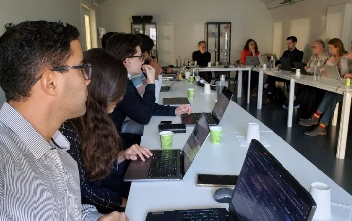{.lightbox group="ibbce2025"}

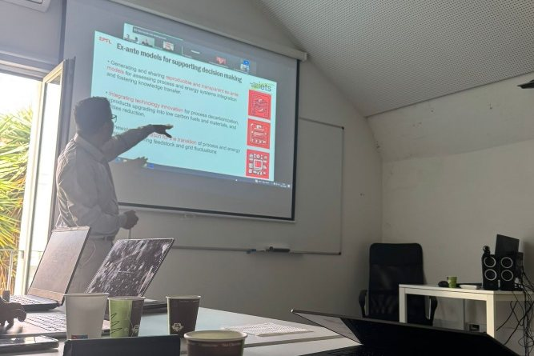{.lightbox group="ibbce2025"}

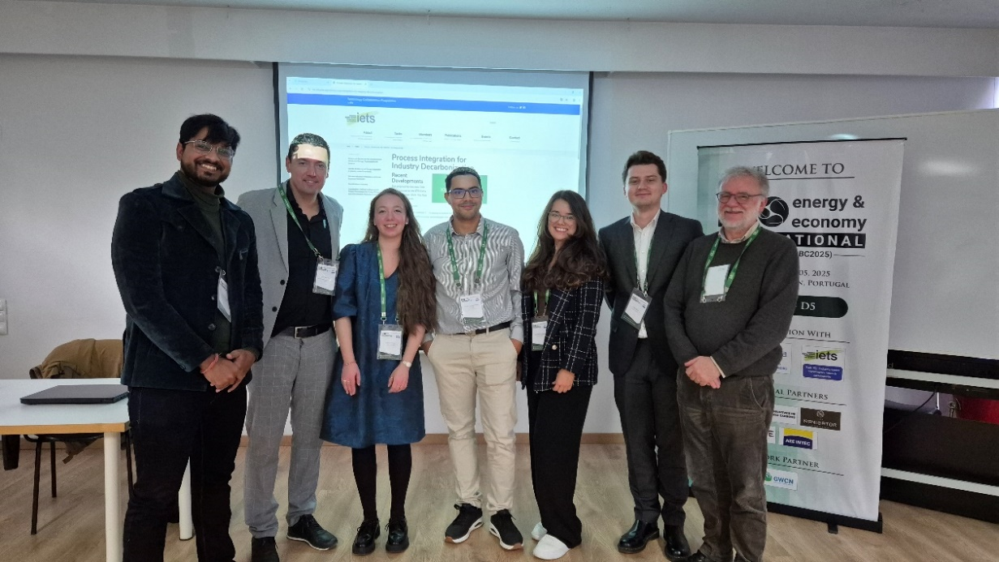{.lightbox group="ibbce2025"}

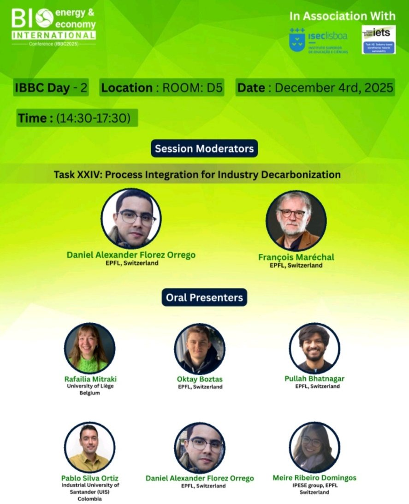{.lightbox group="ibbce2025"}

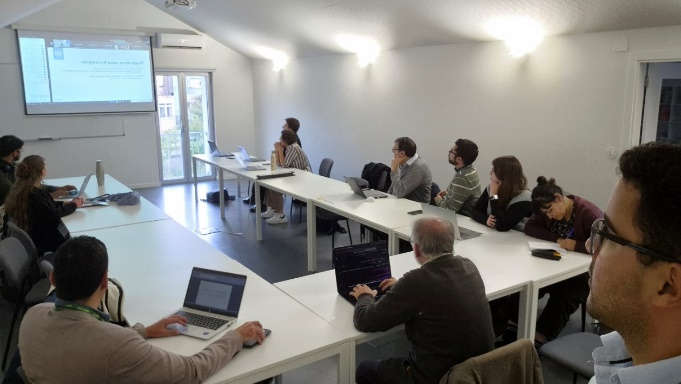{.lightbox group="ibbce2025"}

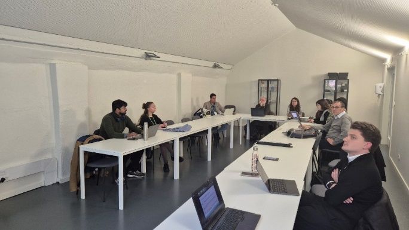{.lightbox group="ibbce2025"}
:::

### Keynote lecture at ESCAPE 35, Ghent, 6–9 July {.unnumbered}

At the 35th European Symposium on Computer Aided Process Engineering (ESCAPE 35), the Task managers gave the one-hour keynote lecture "Process Integration for Industry Decarbonization – Subtask 1: Enabling a shared database of ex-ante models of industrial processes, decarbonization technologies and energy systems featuring sustainability metrics", chaired by Grégoire Léonard (University of Liège) and Henrique Matos (IST Lisbon), before a full-house audience of researchers, industry representatives and policy makers. Task participants also presented technical contributions on synthetic natural gas from waste biomass, reversible solid oxide cells in heavy industry, and renewable electricity for secondary aluminium, circular olefins and biodiesel production ([IPESE at ESCAPE 35](https://ipese-web.epfl.ch/news/ESCAPE35/index.html)).

::: {layout-ncol=2}
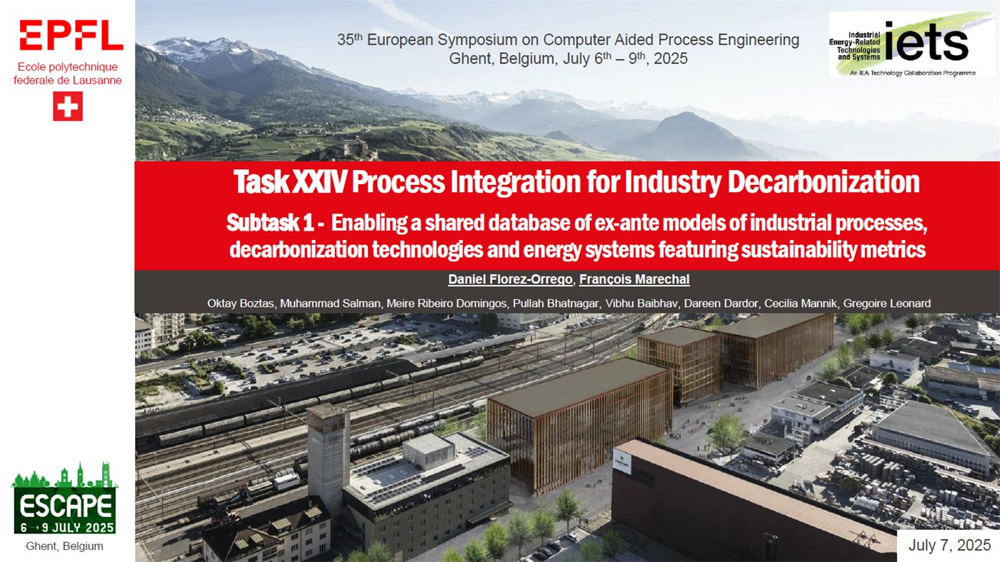{.lightbox group="escape35"}

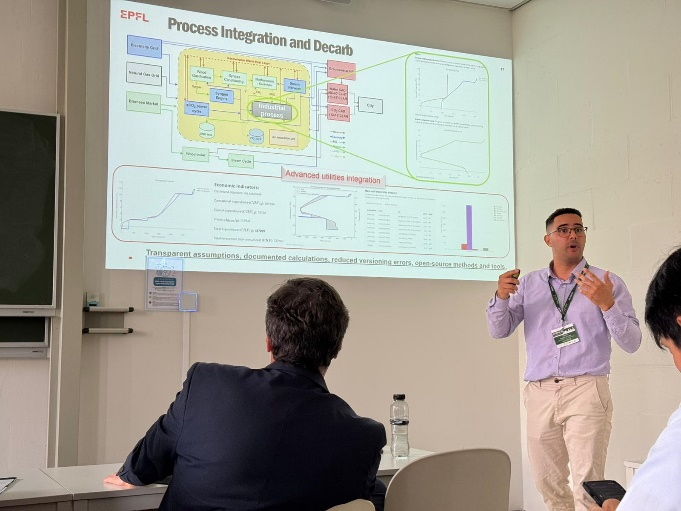{.lightbox group="escape35"}

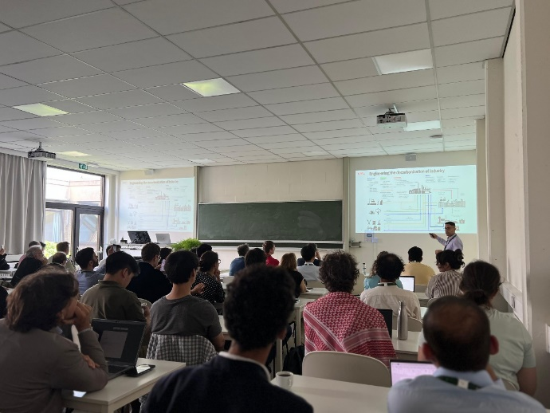{.lightbox group="escape35"}

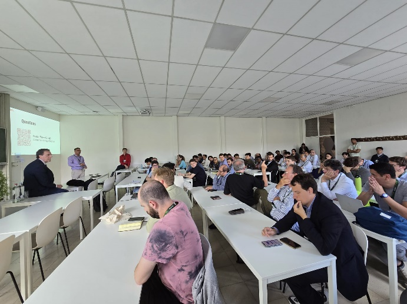{.lightbox group="escape35"}
:::

### EUBCE 2025, Valencia, 9–12 June {.unnumbered}

At the 33rd European Biomass Conference and Exhibition (EUBCE 2025), Task XXIV took part in the special session on biorefineries organized by Task XI "Industry-based biorefineries" (12 June) and presented its activities at the third intra-task meeting of Task XI (13 June), which identified synergies between the two Tasks. Daniel Flórez-Orrego also presented "Sustainable biofuels production via industrial symbiosis and waste heat utilization in heavy industry", a study with the Net Zero Lab Valais consortium.

::: {layout-ncol=2}
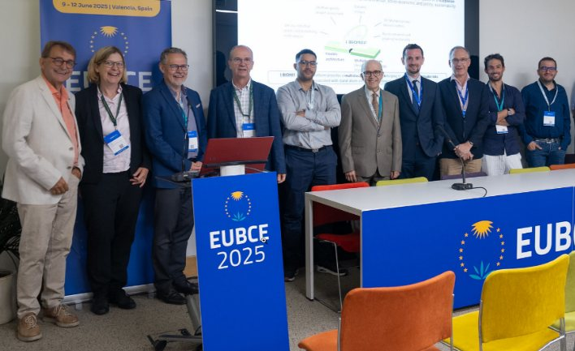{.lightbox group="eubce2025"}

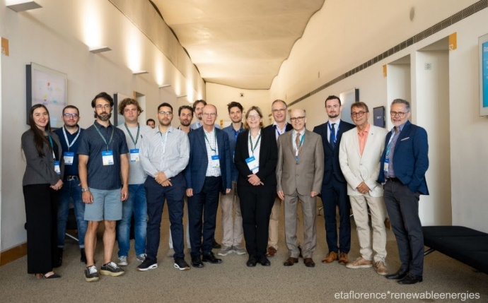{.lightbox group="eubce2025"}

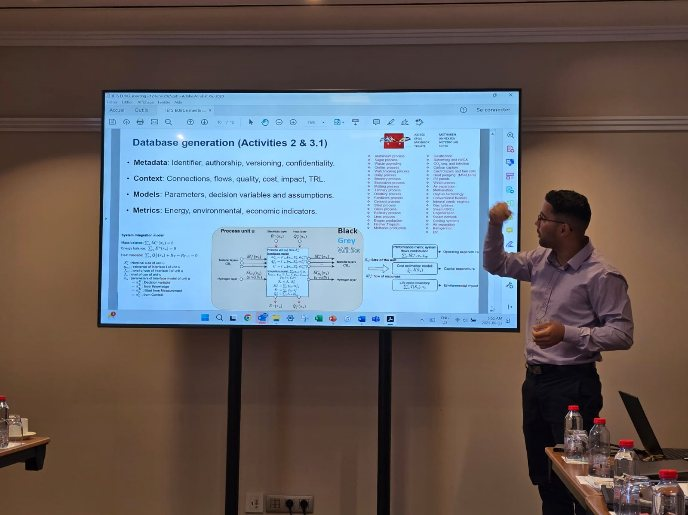{.lightbox group="eubce2025"}

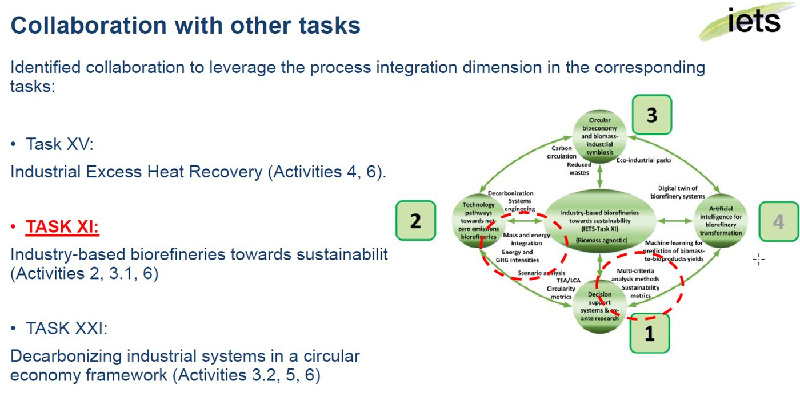{.lightbox group="eubce2025"}

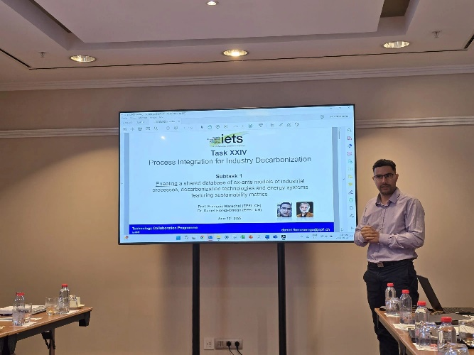{.lightbox group="eubce2025"}

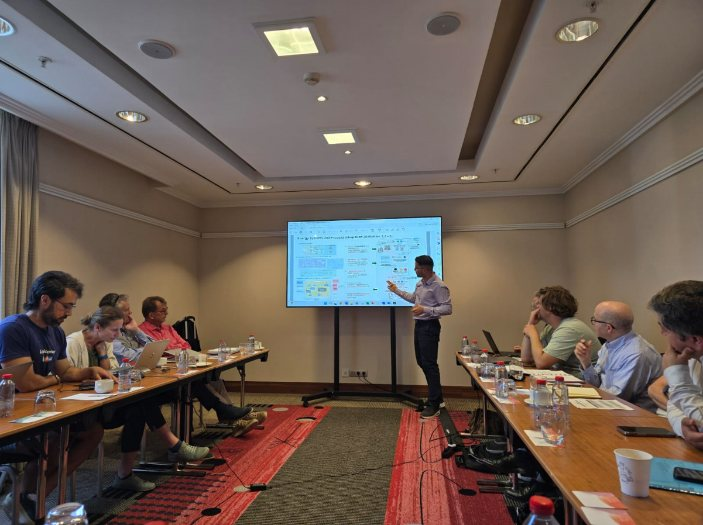{.lightbox group="eubce2025"}

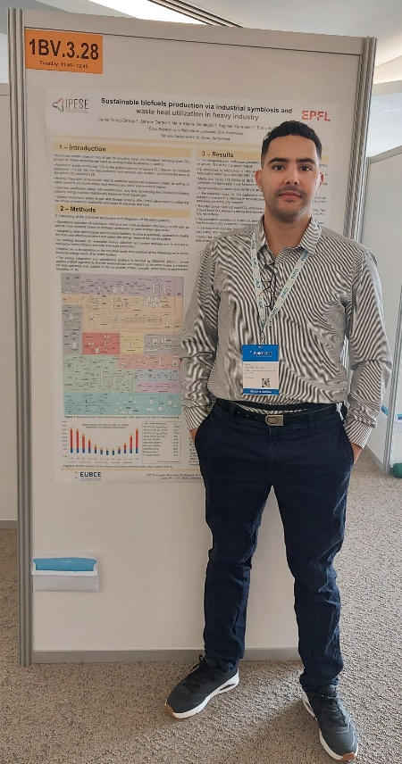{.lightbox group="eubce2025"}

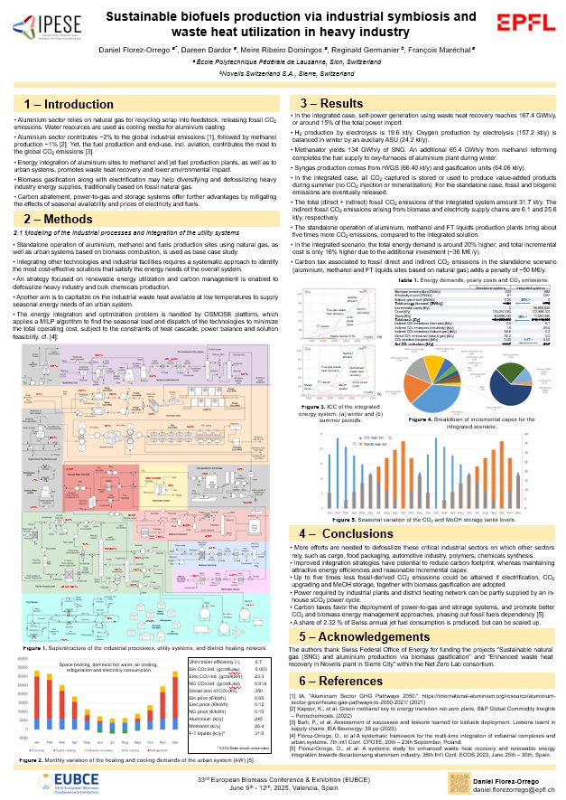{.lightbox group="eubce2025"}
:::

### Joint IETS–ETSAP workshop, online, 10 April {.unnumbered}

In a joint online workshop of IETS TCP and the Energy Technology Systems Analysis Programme (ETSAP) on industrial sectors in energy system models, moderated by Etienne Bernier (Natural Resources Canada) and Anna Krook-Riekkola (ETSAP), Task XXIV presented "Process Integration for Industry Decarbonization: Enabling a Shared Database of Ex-Ante Models", with case studies on aluminium, olefins, watchmaking, sugar and synthetic natural gas production.

::: {layout-ncol=2}
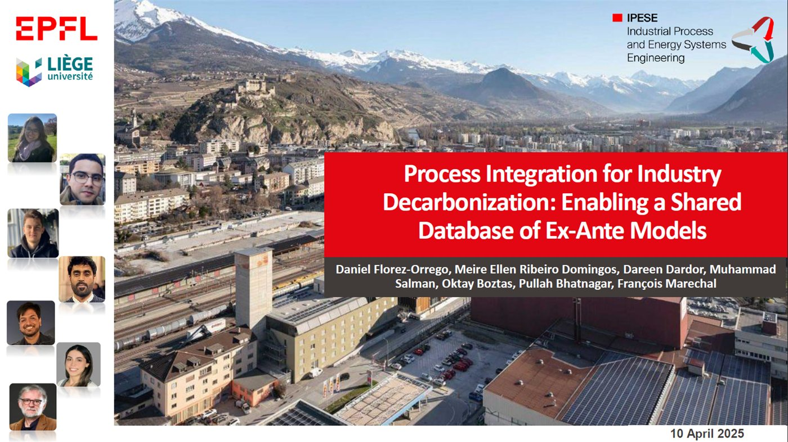{.lightbox group="etsap2025"}

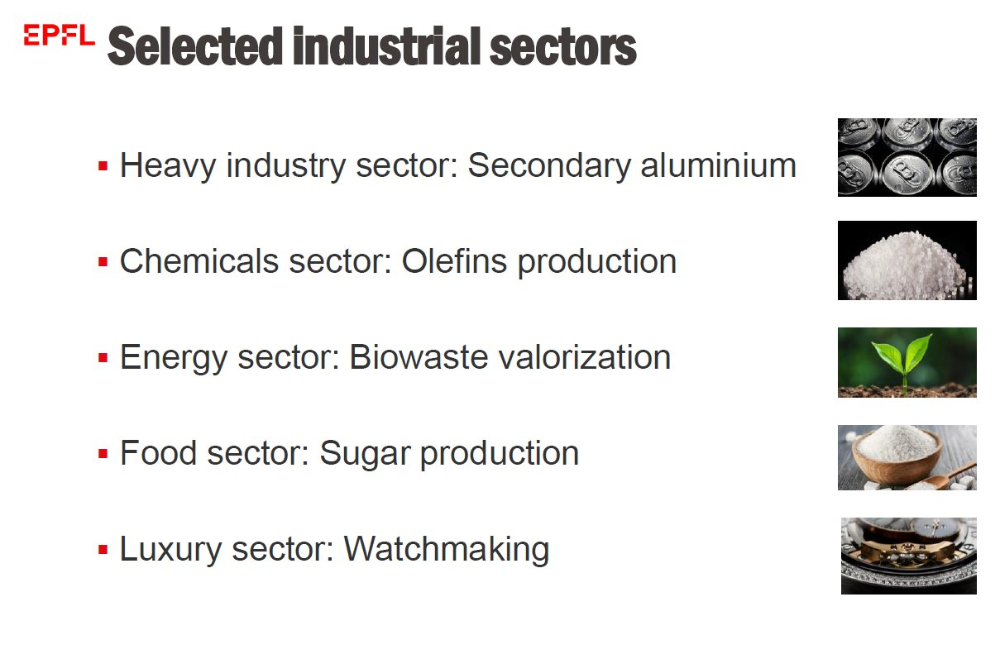{.lightbox group="etsap2025"}
:::

### Continuing education, spring 2025 {.unnumbered}

François Maréchal and Daniel Flórez-Orrego lectured in the Industry Decarbonization module of the [Master of Advanced Studies in Sustainable Energy Systems Engineering](https://www.formation-continue-unil-epfl.ch/formation/sustainable-energy-cas-industry-decarbonisation/), a continuing education programme of EPFL and HES-SO. Its ex-ante models, refined through their use in the course, contribute to this database.

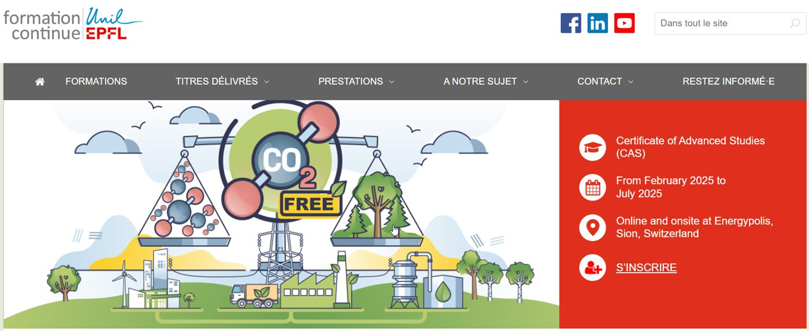{.lightbox width=80%}

### Workshop of IETS Task XV {.unnumbered}

At a workshop of Task XV on industrial waste heat utilization, Dorsan Lepour (EPFL IPESE) presented the Renewable Energy Hub Optimizer (REHO), a decision-support tool for energy communities and neighbourhood-scale building stocks that coordinates the exchanges of energy between buildings and industrial sites. The [recording](https://www.youtube.com/watch?v=I9dwnsJweaA&list=PLuitK2C8j5-v_uD9ST-QvY4t-DcE5lZPj&index=8) is on the YouTube channel of Task XV.

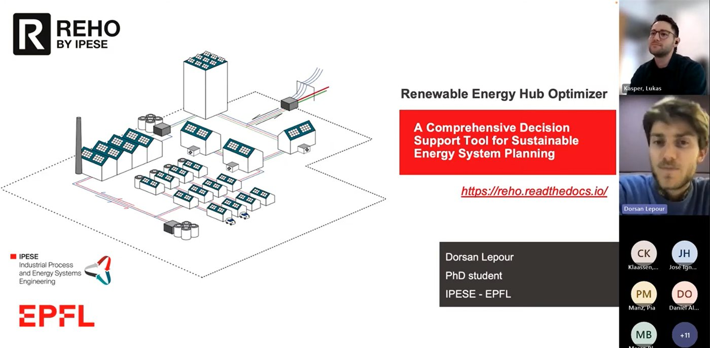{.lightbox width=80%}
