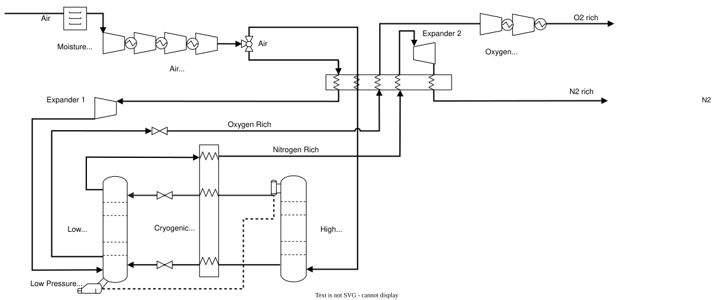

# Cryogenic air separation unit {.unnumbered}



## Description

Many industrial processes need a continuous supply of pure oxygen or nitrogen. Oxygen feeds autothermal reformers in syngas conditioning, oxygen-blown entrained-flow and fluidized-bed gasifiers, and oxy-combustion, where burning a fuel in oxygen instead of air gives higher temperatures and a flue gas that is not diluted by nitrogen, which makes the CO~2~ easier to capture. Nitrogen is used to produce fertilizers, as the gas of plasma torches, and to provide inert atmospheres.

Air is the obvious source of nitrogen, and oxygen can be separated from air or produced by [water electrolysis](../../../2-DecarbTechnologies/Electrochemical/LowTElectrolysis/index.qmd). Air can be separated with membranes, by adsorption or by cryogenic distillation; the cryogenic air separation unit (ASU) is the most suitable when large amounts of oxygen at high purity are needed. It separates the components of air by distillation in a double column, thanks to their different boiling points at cryogenic temperatures.

The model has five units: the ASU, and four compressors that bring its products to the pressure of each use. At its reference size, the ASU produces 21,026 kg/h of oxygen at 99.5 % (molar), about 505 t/day, and 86,417 kg/h of nitrogen, both at 1 bar and 30 °C.

## Key figures

Minimum utility requirements of the unit on its own, from its heat streams. The scale factor *f* multiplies every duty and flow on this page, as the optimization does with the unit's size. Choose the unit to show with the selector.



### Flows



## Model

Throughout this page, names written like `W_cryoASU` are variables of the model: hover one for its definition, click it to go to its row in the [variables](#variables) table. The same holds for the symbols in the equations, for underlined values in the tables and for some labels of @fig-cryoasu. The equations below are generated from the formulas of the model's JSON description, and each is tagged with the name of the variable it defines.

{#fig-cryoasu .lightbox width=100% mv-src="JSON/CryoASU.json" mv-links="Expander 1=Turb1;Expander 2=Turb2;O2 rich=OXYGEN;N2 rich=NITROGEN"}

**Air separation.** Air at 25 °C and 1 bar is dried and compressed to 7.45 bar in four stages (`CompAir1` to `CompAir4`), each followed by an intercooler that cools it to 40 °C (`HX1_Q` to `HX4_Q`). About 95 % of the compressed air is cooled to about −170 °C in the main heat exchanger and fed to the high-pressure column. The remaining 5 % is expanded to about 3 bar and fed to the low-pressure column. The bottoms and overhead of the high-pressure column are cooled by the nitrogen-rich stream leaving the low-pressure column, expanded, and sent to the low-pressure column, where the separation is completed. The two columns are thermally integrated: the condenser of the high-pressure column provides the duty of the reboiler of the low-pressure column. A last expansion of the nitrogen-rich stream to 1 bar provides more cooling in the main heat exchanger. The two expanders recover `Turb1` and `Turb2` of power, so the ASU takes `W_cryoASU`, 6,054 kW, or 0.29 kWh per kg of oxygen.

**Products.** The ASU, `CryoASUnit`, delivers `OXYGEN`, 21,026 kg/h of oxygen-rich stream at 99.5 % O~2~ (molar), and `NITROGEN`, 86,417 kg/h of nitrogen-rich stream at 93 % N~2~, both at 1 bar and 30 °C, on the `oxyvent` and `nitrovent` layers. From there, each product is vented, used at low pressure, or compressed.

**Compression.** Four units compress the products for the uses that need them at higher pressure. `CryoASUO2ToProc` compresses the oxygen to 30 bar in three stages, for autothermal reformers and entrained-flow gasifiers (`W_O2proc`); `CryoASUO2ToExp` compresses it to 200 bar in five stages, for export (`W_O2exp`). `CryoASUN2ToPlas` compresses the nitrogen to 7 bar in two stages, for plasma torches (`W_N2plas`); `CryoASUN2ToExp` compresses it to 200 bar in five stages, for export in cylinders (`W_N2exp`). Each stage is followed by an intercooler.

**Investment cost.** The ASU costs `SpecInvASU`, 50 MEUR per 1,000 t/day of oxygen, scaled linearly with its oxygen production, updated from 2014 to 2020 with the CEPCI (`CEPCI2014`, `CEPCI2020`) and annualized over the lifetime `n` at the interest rate `i`, to give `Cinv2_CryoASU`. The compressors have no cost data.



### Using the model

The five units are scaled independently by the optimization. Each compressor is sized for all the oxygen or all the nitrogen of the ASU at its reference size, so that it runs at the same size factor as the ASU when all of that product is compressed. The oxygen or nitrogen that is neither used at 1 bar nor compressed stays on the `oxyvent` or `nitrovent` layer, so another unit, such as a vent, must take it for the layer to balance. Venting a product the plant has paid to separate lowers the efficiency of the system.

### Modelling choices

**Source.** The flows, temperatures, heat loads and powers are one operating point of an Aspen HYSYS model. The model is a translation of a ROSMOSE (R Markdown) model into OSMOSE Lua; its layers follow the names used by the other models of the database (`Elec`, `Oxygen`, `oxyvent`, `oxyprocess`, `Nitrogen`), so that its products can feed them.

**Heat streams.** Only the intercoolers of the compressors are heat streams. The heat exchange inside the cold box, between the main heat exchanger, the columns and the cryogenic heat recovery, is internal to the ASU. The air is drawn from the atmosphere and is not given as a connector.

**Intercooler of the third stage of oxygen export.** The heat load of `HX10_Q` is 783.8 kW, but the ROSMOSE file comments it as 0.035137 kWh per kg of oxygen, which would be 738.8 kW: one of the two has swapped digits. The model keeps 783.8 kW, which follows the trend of the other stages.

**Comparison.** The cement model includes a simplified ASU that produces oxygen at 95 % purity with 0.226 kWh per kg of oxygen. This model produces it at 99.5 % with 0.29 kWh/kg, before any compression.

## Variables



## Units and connectors



## Heat integration

None of the five units needs heating: they only release heat from their intercoolers. At their reference sizes, the ASU releases 6,695 kW from below 100 °C to 40 °C; the oxygen compressors 2,302 kW (to 30 bar) or 4,011 kW (to 200 bar), and the nitrogen compressors 5,015 kW (to 7 bar) or 18,932 kW (to 200 bar), from up to 136 to 199 °C. This heat can preheat water or boiler feed water, or be upgraded by a heat pump.

### Heat streams



### Composite curves



### Grand composite curve



## Supplementary material

| File | Content |
|:--|:--|
| [CryoASU_ET.lua](Osmoses/CryoASU_ET.lua) | OSMOSE (Lua) implementation of the model |
| [CryoASU.json](JSON/CryoASU.json) | Model description in the Task XXIV JSON format |
| [cryoASU.svg](Figures/cryoASU.svg) | Diagram of the cryogenic air separation unit |
| [cryoASU.drawio](Figures/cryoASU.drawio) | Editable diagram |

## References


