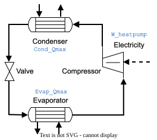

---
aliases:
  - /1-EnergyTechnologies/HeatPump/index.html
---

# Heat pump {.unnumbered}



## Description

Industrial processes reject large amounts of low temperature heat that cannot be recovered internally. A heat pump upgrades part of this waste heat: its working fluid evaporates at low temperature, taking heat from the process, is compressed, and condenses at a higher temperature, delivering heat back to the process. The compressor runs on electricity, so the heat pump turns waste heat and electricity into useful heat.

The model delivers 3,500 kW at 110 °C from heat taken at 96 °C. Its performance follows from the Carnot coefficient of performance (COP) between the two temperatures and an exergy efficiency.

## Key figures

Minimum utility requirements of the unit on its own, from its heat streams. The scale factor *f* multiplies every duty and flow on this page, as the optimization does with the unit's size.



### Flows



## Model

Throughout this page, names written like `Cond_Qmax` are variables of the model: hover one for its definition, click it to go to its row in the [variables](#variables) table. The same holds for the symbols in the equations and for underlined values in the tables. The equations below are generated from the formulas of the model's JSON description, and each is tagged with the name of the variable it defines. @fig-heatpump shows the cycle.

{#fig-heatpump .lightbox width=40%}

**Performance.** The Carnot coefficient of performance `COPcarnot` is the condenser temperature `Cond_Tin`, in kelvin, divided by the temperature lift from the evaporator temperature `Evap_Tin`. The actual `COP` is the Carnot COP times the exergy efficiency `exeff`. For a lift of 14 K, from 96 °C to 110 °C, and an exergy efficiency of 0.5, the COP is 13.7.

**Energy balance.** The condenser heat load `Cond_Qmax` sets the size of the unit. The compressor electricity `W_heatpump` is `Cond_Qmax` divided by the COP, and the evaporator takes the rest of the condenser heat from the process, `Evap_Qmax`.

**Investment cost.** The investment cost is 300 EUR per kW of condenser heat in 2008 euros, or 750 EUR/kW for heat pumps below 500 kW. It is updated to 2020 with the cost indices `CEPCI_2020` and `CEPCI_2008` and annualized with the capital recovery factor `Annuity`, over the lifetime `n` at the interest rate `i`, to give `Cinv2_HP`. The formula below uses the 300 EUR/kW rate, which applies at the reference size of 3,500 kW.



### Using the model

To apply the model to another process, change `Evap_Tin` and `Cond_Tin`: the evaporator goes below the process pinch, where heat is rejected, and the condenser above it, where heat is needed. `Evap_Tout` and `Cond_Tout` take the same values. `Cond_Qmax` sets the size and `exeff` the efficiency. The COP, the electricity, the evaporator load and the cost are calculated from these. `Cond_Tin` must stay above `Evap_Tin`, and the closer the two, the higher the COP.

## Variables



## Unit and connectors



## Heat integration

The evaporator is a cold stream at 96 °C and the condenser a hot stream at 110 °C, both at constant temperature. On its own, the unit's condenser could heat its own evaporator, which is what the key figures and the curves below show; in practice, the heat pump is only useful when integrated with a process that rejects heat below the evaporator temperature and needs heat above the condenser temperature, across its pinch.

### Heat streams



### Composite curves



### Grand composite curve



## Supplementary material

| File | Content |
|:--|:--|
| [Heatpump_ET.lua](Osmoses/Heatpump_ET.lua) | OSMOSE (Lua) implementation of the model |
| [HeatPump.json](JSON/HeatPump.json) | Model description in the Task XXIV JSON format |
| [HeatPump.svg](Figures/HeatPump.svg) | Diagram of the heat pump cycle |

## References


