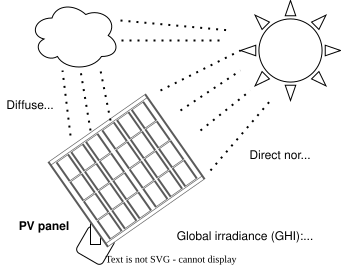

# Photovoltaic panels {.unnumbered}



## Description

Photovoltaic (PV) panels convert sunlight into electricity. Their output depends on the solar irradiance they receive and on their temperature. The global horizontal irradiance is the solar power falling on a horizontal surface, in W/m², and sets the potential yield; it can be taken from insolation maps or tables built on 30 to 50 years of data. Part of the irradiance passes through the glass of the panel and is absorbed. Only a fraction is converted into electricity; the rest heats the panel, and since the semiconductor is less efficient when hot, a warmer panel produces less.

The model gives the electricity produced by a PV installation for a given irradiance and ambient temperature, with an efficiency that decreases as the panel temperature rises. It follows the model of Ashouri (2014). At its reference size, 4,000 m² of panels on a 16,000 m² area, it produces 59.1 kW at an irradiance of 100 W/m².

{#fig-pvpanel width=60%}

## Key figures

The unit has no heat streams: it only delivers electricity. The scale factor *f* multiplies every flow on this page, as the optimization does with the unit's size.



## Model

Throughout this page, names written like `E_default` are variables of the model: hover one for its definition, click it to go to its row in the [variables](#variables) table. The same holds for the symbols in the equations and for underlined values in the tables. The equations below are generated from the formulas of the model's JSON description, and each is tagged with the name of the variable it defines.

**Panel temperature.** The panel temperature, `T_panel`, follows from its energy balance. The panel absorbs the fraction `f_glass` of the irradiance `GI`, converts part of it into electricity, and loses the rest to the ambient air at `T_ext` through its thermal transmission coefficient `U_glass`. At 100 W/m² and 14.4 °C, the panel is at 17.0 °C.

**Efficiency.** The efficiency, `efficiency`, is the reference efficiency `efficiency_ref` at the reference temperature `T_ref`, reduced by the temperature coefficient `efficiency_var` for every kelvin above it. `U_glass` and `efficiency_var` depend on the type of panel and are given by the manufacturer. Below 25 °C, as at the reference conditions, the efficiency is slightly higher than the reference: 14.8 %.

**Electricity production.** The panel area, `size_real`, is the installation area `size_ref`, for instance a roof, times `area_factor`, since obstacles and spacing leave only part of it for panels. The electricity produced, `E_default`, is the irradiance times the panel area times the efficiency.

**Investment cost.** The panels cost `costinv` per m², annualized with `Annuity` over the lifetime `n` at the interest rate `i`, to give `Cinv2`.



### Using the model

The irradiance `GI` and the ambient temperature `T_ext` change with time: in OSMOSE they are read for each period from a weather file, and the values here are one operating point. The size factor of the unit goes from 0 to 1, so the optimization can install up to `size_real` of panels; to allow a larger installation, change `size_ref` or `area_factor`.

### Modelling choices

The values are those of the Lua file. The R Markdown description of the model uses an example with other values: an ambient temperature of 10 °C, an installation area of 11,689.7 m², 300 CHF/m² for the panels, an interest rate of 6 %, a lifetime of 25 years and a size factor of up to 100. The costs are in CHF. The panels have no operating cost.

## Variables



## Unit and connectors



## Supplementary material

| File | Content |
|:--|:--|
| [PVpanel2_ETraluca.lua](Osmoses/PVpanel2_ETraluca.lua) | OSMOSE (Lua) implementation of the model |
| [PVpanel.Rmd](Rmarkdowns/PVpanel.Rmd) | Description of the model in R Markdown, with its ROSMOSE implementation |
| [PVpanel.json](JSON/PVpanel.json) | Model description in the Task XXIV JSON format |
| [PVpanel.svg](Figures/PVpanel.svg) | Structure of a photovoltaic panel |
| [Ashouri 2014.pdf](Documents/Ashouri%202014.pdf) | Doctoral thesis of Ashouri (2014), from which the model is taken |

## References


