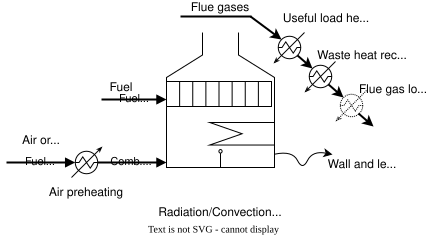

---
aliases:
  - /1-EnergyTechnologies/FurnaceNG/index.html
---

# Natural gas furnace {.unnumbered}



## Description

A natural gas furnace burns natural gas with air and transfers the heat of the flue gas to the process: first by radiation in the radiant section, then by convection as the flue gas cools down to the stack. It is the conventional hot utility for high temperature heat in industry.

The model is sized by its useful heat load, 1,000 kW at the reference size, of which 961 kW reach the process above the stack temperature. It accounts for two losses: the heat lost through the walls and the heat of the hot gas escaping the furnace. The combustion air can be preheated, and the CO~2~ of the flue gas is split between the CO~2~ emitted with the escaping gas and the CO~2~ leaving at the stack, which can be captured.

## Key figures

Minimum utility requirements of the unit on its own, from its heat streams. The scale factor *f* multiplies every duty and flow on this page, as the optimisation does with the unit's size.



### Flows



## Model

Throughout this page, names written like `Q_demand` are variables of the model: hover one for its definition, click it to go to its row in the [variables](#variables) table. The same holds for the symbols in the equations and for underlined values in the tables. The equations below are generated from the formulas of the model's JSON description, and each is tagged with the name of the variable it defines. @fig-furnace shows the furnace and where its heat goes.

{#fig-furnace .lightbox width=70%}

**Fuel demand and losses.** The useful heat load `Furnace_natGas_LOAD` is a fraction 1 − `walllossfactor` − `hotgasescfactor` of the fuel power. The wall loss `Furnace_natGas_WALL` and the hot gas escape loss `Furnace_natGas_ESC` follow from it, and the natural gas demand `Q_demand` (LHV) is the sum of the three: 1,250 kW for 1,000 kW of useful heat with 10 % of each loss.

**Flue gas cooling curve.** The flue gas is represented by a constant heat capacity flow, set so that the fuel power heats it from the ambient temperature `To` to the adiabatic flame temperature `Tad` with stoichiometric air (`cpg`). The excess air, `a` − 1 times the stoichiometric air mass `v`, adds its own heat capacity and lowers the flame temperature to `Tad_corr` (1,931 °C). The heat released by the flue gas is then split by temperature: from `Tad_corr` down to the radiant section temperature `Trad`, the radiant heat `Q_radiation`; from `Trad` to `Troof`, the convective heat `Q_convroof`; from `Troof` to `Tstack`, `Q_convrecov`; and below `Tstack`, the stack loss `Q_stack`. The four add up to the useful heat load.

**Air preheating.** Preheating the stoichiometric air from `To` to `Tprin` takes `Q_preh`, which the flue gas returns above `Trad`, so it is added to the radiant heat (`Q_radpreh`). Preheating only pays when it is done below the pinch of the process the furnace serves. At the default `Tprin` of 26 °C, it is negligible.

**Losses.** The same cooling curve is applied to the wall loss (variables ending in `_wl`) and to the hot gas escape (`_ae`). The radiant and convective shares of the wall loss, and the whole heat of the escaping gas (`Q_total_ae`), are released at the dissipation temperature `Tloss` into a separate heat cascade, LGWH, so they cannot heat the process.

**CO~2~.** The natural gas is taken as methane, which gives one kmol of CO~2~ per kmol of fuel. `TotalCO2Flow` is the CO~2~ produced, `EmitCO2Flow` the share that leaves with the escaping gas, and `CapturableCO2Flow` the share that leaves at the stack.

**Investment cost.** The specific cost of the heater, `Spec_heaterCost`, is the cost per installed kW `Spec_heaterCost_installed` times the ratio of installed to average power `inst2avgratio`. Applied to `Q_demand` and annualised with the capital recovery factor `Annuity` over the lifetime `n` at the interest rate `i`, it gives the annualised investment cost `Cinv2_NGFur`, in 2020 euros (the CEPCI ratio in the formula is 1).



### Modelling choices

**Heat streams.** The radiant heat is one isothermal stream at `Trad`; the convective heat and its recovery are two streams from `Trad` to `Troof` and from `Troof` to `Tstack`. The stack loss `Q_stack` (39 kW, and 4.9 kW for the wall loss share) is computed but not given as a heat stream, so the flue gas is not cooled below `Tstack`. The wall loss share of the recovery from `Troof` to `Tstack`, `convrecGas_wl`, is in the default heat cascade, while the other loss streams are in LGWH.

## Variables



## Unit and connectors



## Heat integration

The furnace is a hot utility: in the default heat cascade, it delivers 961 kW, of which 436 kW at 1,100 °C, and needs 0.4 kW for the air preheating. The 245 kW of losses go to the LGWH cascade at 30 °C.

### Heat streams



### Composite curves



### Grand composite curve



## Supplementary material

| File | Content |
|:--|:--|
| [FurnacePrehNG_ET.lua](Osmoses/FurnacePrehNG_ET.lua) | OSMOSE (Lua) implementation of the model |
| [FurnacePrehNG.json](JSON/FurnacePrehNG.json) | Model description in the Task XXIV JSON format |
| [Furnace.svg](Figures/Furnace.svg) | Diagram of the furnace |

## References


