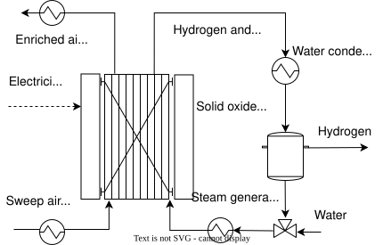

---
aliases:
  - /2-DecarbTechnologies/HighTElectrolysis/index.html
---

# High-temperature electrolysis {.unnumbered}



## Description

A solid oxide electrolysis cell (SOEC) converts steam, and optionally CO~2~ in co-electrolysis, into hydrogen and carbon monoxide, and produces a separate oxygen-rich stream. The cell is a ceramic electrolyte that conducts oxygen ions, between two porous electrodes. At the cathode, steam takes up electrons and splits into hydrogen and oxygen ions; under the applied voltage, the ions cross the dense electrolyte to the anode, where they release their electrons and form oxygen.

SOECs operate at 600 to 850 °C, which the ceramic electrolyte needs to conduct the oxygen ions well, against 60 to 100 °C for alkaline and PEM electrolyzers. The high temperature gives a higher thermodynamic efficiency and faster kinetics: the voltage needed for electrolysis falls by about 25 to 30 % from 60 to 800 °C, and a SOEC typically operates at the thermoneutral voltage of 1.29 V, against about 1.48 V for low-temperature water electrolysis. Its stack consumes 33 to 38 kWh of electricity per kg of hydrogen, against more than 48 kWh/kg for [low-temperature electrolysis](../LowTElectrolysis/index.qmd), and part of the energy can come as heat instead, from the waste heat of the process.

Like other electrolyzers, SOECs turn surplus renewable electricity into hydrogen that can be stored or converted into synthetic natural gas, methanol or other chemicals (power-to-gas). The model gives the mass and energy balances of a SOEC system per 1 kg/h of hydrogen, from an Aspen Plus model.

## Key figures

Minimum utility requirements of the unit on its own, from its heat streams. The scale factor *f* multiplies every duty and flow on this page, as the optimization does with the unit's size.



### Flows



## Model

Throughout this page, names written like `E_SOEC` are variables of the model: hover one for its definition, click it to go to its row in the [variables](#variables) table. The same holds for the symbols in the equations, for underlined values in the tables and for the labels of @fig-soec. The equations below are generated from the formulas of the model's JSON description, and each is tagged with the name of the variable it defines.

{#fig-soec .lightbox width=80% mv-src="JSON/SOEC.json" mv-links="Electricity consumption=E_SOEC;Sweep air heating=hx_B3_ho;Water=massflowH2O;Enriched air cooling=hx_B5_ho;Hydrogen and water=hx_B6_ho;Steam generator=hx_B12_ho;Hydrogen=massflowH2;Water condenser=hx_B19_ho"}

**Mass balance.** Per 1 kg/h of hydrogen (`massflowH2`), the system takes `massflowH2O`, 10.78 kg/h of water, and a sweep air, `massflowAir`, of 55.66 kg/h. The unconverted water, `massflowH2O_out`, 1.84 kg/h, is condensed and recovered in molecular sieves, so the net water consumption, `Water_bal`, is 8.94 kg/h. The sweep air carries away the oxygen produced and leaves as enriched air, `massflow_EnrAir`, with 30 % O~2~ (molar). The flows close at 66.4 kg/h in and out.

**Electricity.** The system takes `Elec_input`, 34.2 kW, including the overpotentials of the cells (`E_SOEC`), or 34.2 kWh per kg of hydrogen.

**Heat streams.** The feed water is heated from 25 to 99 °C (`hx_B13_ho`), evaporated (`hx_B12_ho`) and superheated to 800 °C (`hx_B11_ho`), and the sweep air is heated from 25 to 700 °C (`hx_B3_ho`). Leaving the stack, the enriched air is cooled from 712 to 25 °C (`hx_B5_ho`), and the hydrogen with the unconverted steam from 800 to 25 °C in four steps (`hx_B6_ho`, `hx_B17_ho`, `hx_B18_ho`, `hx_B19_ho`), the last of which condenses the water.

**Investment cost.** The system costs `costinv`, 1,800 EUR per kW of electricity, annualized over the lifetime `n` at the interest rate `i`, to give `Cinv2_SOEC`.



### Modelling choices

The values are one operating point of the Aspen Plus model, per 1 kg/h of hydrogen; the unit scales them linearly. The minimum temperature difference contribution depends on the phase of each stream: `dtmin_gas` for gases, `dtmin_liq` for liquids and `dtmin_2ph` for evaporating or condensing streams. The sweep air is drawn from the atmosphere and is not given as a connector. The model is a translation of a ROSMOSE (R Markdown) model into OSMOSE Lua; the Lua file corrects the formula of the net water consumption, which used an undefined variable, and the units of the heat loads.

## Variables



## Unit and connectors



## Heat integration

The cold streams need 23.3 kW and the hot streams release 17.9 kW per kg/h of hydrogen. Heat recovery covers 16.7 kW, so the system needs at least 6.6 kW of hot utility and 1.25 kW of cold utility; the pinch is at 58 °C shifted. Almost all of the hot utility, 6.3 kW, is needed to evaporate the feed water at about 100 °C, and only about 0.3 kW above 700 °C: the hot enriched air and hydrogen leaving the stack heat the sweep air and the steam. Waste heat from a process at a little above 100 °C can therefore replace most of the external heat, which is one of the advantages of high-temperature electrolysis.

### Heat streams



### Composite curves



### Grand composite curve



## Supplementary material

| File | Content |
|:--|:--|
| [SOEC_ET.lua](Osmoses/SOEC_ET.lua) | OSMOSE (Lua) implementation of the model |
| [SOEC.json](JSON/SOEC.json) | Model description in the Task XXIV JSON format |
| [soecelectrolyzer.svg](Figures/soecelectrolyzer.svg) | Diagram of the solid oxide electrolysis system |
| [soecelectrolyzer.drawio](Figures/soecelectrolyzer.drawio) | Editable diagram |

## References


