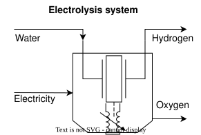

---
aliases:
  - /2-DecarbTechnologies/LowTElectrolysis/index.html
---

# Low-temperature electrolysis {.unnumbered}



## Description

Low-temperature water electrolysis is the most mature technology for producing hydrogen from electricity. In an alkaline electrolyzer, two electrodes operate in a liquid alkaline electrolyte, typically potassium or sodium hydroxide at 25 to 40 wt%, at 80 to 90 °C; liquid water is split into hydrogen and oxygen. Above the thermoneutral voltage, the irreversibilities of the cells turn part of the electricity into waste heat, and they grow with the current density, which limits the hydrogen yield and the efficiency. Low-temperature electrolyzers consume more than 50 kWh of electricity per kg of hydrogen, against 33 to 38 kWh/kg for the stack of a high-temperature [solid oxide electrolyzer](../HighTElectrolysis/index.qmd), which can use waste heat from the process instead.

Electrolyzers turn surplus renewable electricity into hydrogen that can be stored or converted into synthetic natural gas, methanol or other chemicals (power-to-gas), and so help to balance the intermittency of solar and wind power. The model was used in this way by [Domingos et al. (2023)](https://doi.org/10.1016/j.compchemeng.2023.108305), where an electrolyzer converts surplus electricity during the summer into hydrogen for the methanation of the CO~2~ captured at a pulp and ammonia plant.

The model has three units: the electrolyzer, and two compressors that bring its oxygen to 30 bar for use in the process or to 200 bar for export. At its reference size, the electrolyzer produces 111.1 kg/h of hydrogen and 888.9 kg/h of oxygen from 1,000 kg/h of water.

## Key figures

Minimum utility requirements of the unit on its own, from its heat streams. The scale factor *f* multiplies every duty and flow on this page, as the optimization does with the unit's size. Choose the unit to show with the selector.



### Flows



## Model

Throughout this page, names written like `E_AlkaElec` are variables of the model: hover one for its definition, click it to go to its row in the [variables](#variables) table. The same holds for the symbols in the equations, for underlined values in the tables and for the labels of @fig-lowtelectrol. The equations below are generated from the formulas of the model's JSON description, and each is tagged with the name of the variable it defines.

{#fig-lowtelectrol .lightbox width=60% mv-src="JSON/ElectroAlka.json" mv-links="Oxygen=massflowO2;Electricity=E_AlkaElec;Water=waterCons;Hydrogen=massflowH2"}

**Mass balance.** The electrolyzer, `AElectrolyzer`, takes `massflowH2O`, 1,000 kg/h of water (`waterCons`, 1 m³/h), and splits it into hydrogen, `massflowH2`, with the stoichiometric mass ratio `H2toH2O_massratio` of 1/9, and oxygen, `massflowO2`, the rest of the water.

**Electricity and heat.** The electrolyzer takes `E_AlkaElec_spec`, 55 kWh of electricity per kg of hydrogen, so 6,111 kW at its reference size (`E_AlkaElec`). Its hydrogen holds 39.4 kWh/kg on a higher heating value basis (`HHV_H2`), so 72 % of the electricity. The cooling duty of the system, `Q_AlkaElec`, is released from 80 to 30 °C, at `Q_AlkaElec_spec`, 0.30 kWh per kg of hydrogen.

**Oxygen compression.** The oxygen leaves the electrolyzer at 1 bar on the `oxyvent` layer. It can be vented, or compressed in one of two units. `O2ToProcWSU` compresses it to 30 bar for use in the process, in three intercooled stages (`Qo2cp1procwsu` to `Qo2cp3procwsu`), with `W_net_procO2wsu` of electricity. `O2ToExportWSU` compresses it to 200 bar for export, in the same three stages and three more (`Qo2cp1expwsu` to `Qo2cp3expwsu`), with `W_net_exportO2wsu`. Every intercooler cools the oxygen to 30 °C.

**Investment cost.** The electrolyzer costs `costinv`, 1,200 EUR per kW of electricity, annualized over the lifetime `n` at the interest rate `i`, to give `Cinv2_AlkaElec`. The oxygen compressors have no cost data.



### Using the model

The three units are scaled independently by the optimization. Each oxygen compressor is sized for all the oxygen of the electrolyzer at its reference size, so that the three units run at the same size factor when all the oxygen is compressed. The oxygen that is neither used nor exported stays on the `oxyvent` layer, so another unit, such as a vent, must take it for the layer to balance.

### Modelling choices

**Heat of the electrolyzer.** The heat stream of the electrolyzer is the cooling duty given in the ROSMOSE model, 33.8 kW at the reference size, which that model describes as the waste heat of compressing the hydrogen to 30 bar. The heat released by the cells themselves is not given as a heat stream. By an energy balance on the higher heating value, the 55 kWh/kg of electricity that do not end up in the hydrogen, about 15.6 kWh/kg or 1.7 MW at the reference size, end up as heat, most of it in the electrolyte at 80 to 90 °C.

**Hydrogen.** The stoichiometric ratio is rounded to 1/9; the exact value is 2.016/18.015, or 0.112. The pressure of the hydrogen is not given.

**Source.** The model is a translation of a ROSMOSE (R Markdown) model into OSMOSE Lua. The ROSMOSE file had a missing `%` in the formula of `E_AlkaElec`, which the Lua file corrects.

## Variables



## Units and connectors



## Heat integration

None of the three units needs heating: they only release heat, all of it between 180 and 30 °C. At their reference sizes, the electrolyzer releases 33.8 kW from 80 to 30 °C, the oxygen compressor to the process 103.7 kW from up to 180 °C, and the oxygen compressor to export 165.4 kW from up to 180 °C, enough to preheat water or to raise low-pressure steam elsewhere in the plant.

### Heat streams



### Composite curves



### Grand composite curve



## Supplementary material

| File | Content |
|:--|:--|
| [ElectroAlka_ET.lua](Osmoses/ElectroAlka_ET.lua) | OSMOSE (Lua) implementation of the model |
| [ElectroAlka.json](JSON/ElectroAlka.json) | Model description in the Task XXIV JSON format |
| [lowtelectrol.svg](Figures/lowtelectrol.svg) | Diagram of the low-temperature electrolysis system |
| [lowtelectrol.drawio](Figures/lowtelectrol.drawio) | Editable diagram |

## References


