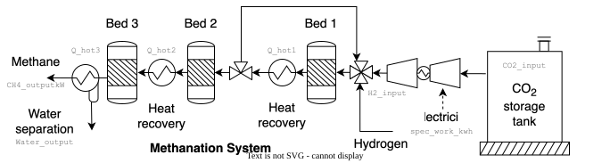

# Methanation {.unnumbered}



## Description

Methanation converts CO~2~ and hydrogen into methane: CO~2~ + 4 H~2~ → CH~4~ + 2 H~2~O. With hydrogen from electrolysis and captured CO~2~, it turns renewable electricity into synthetic natural gas that can be stored and distributed in the gas grid (power-to-gas). The reaction releases a large amount of heat, which is recovered as the gas is cooled between and after the reactors.

The model has two units: the methanation unit, operating at 30 bar, and the compressor that brings the CO~2~ from 1 to 30 bar. At its reference size, the methanation unit produces 1 kmol/h of methane, 16 kg/h or 222 kW on a lower heating value basis.

## Key figures

Minimum utility requirements of the unit on its own, from its heat streams. The scale factor *f* multiplies every duty and flow on this page, as the optimization does with the unit's size. Choose the unit to show with the selector.



### Flows



## Model

Throughout this page, names written like `CH4_outputkW` are variables of the model: hover one for its definition, click it to go to its row in the [variables](#variables) table. The same holds for the symbols in the equations and for underlined values in the tables. The equations below are generated from the formulas of the model's JSON description, and each is tagged with the name of the variable it defines. @fig-methanation shows the system.

{#fig-methanation .lightbox width=100% mv-src="JSON/Methanation.json"}

**Mass balance.** The methanation unit takes 44 kg/h of CO~2~ (`CO2_input`) and 8 kg/h of hydrogen (`H2_input`), and produces 16 kg/h of methane (`CH4_ouput`) and 36 kg/h of water (`Water_output`): one kmol/h of methane, in the stoichiometric ratio of the reaction. The methane leaves as power, `CH4_outputkW`, from its lower heating value `LHV_CH4`.

**Heat release.** The heat loads are given per kg of methane. The heat is released in three cooling steps: from 542 to 300 °C (`Q_hot1`), from 411 to 200 °C (`Q_hot2`), and from 202 to 40 °C (`Q_hot3`), where most of the water condenses. Together they release 61.7 kW, or 28 % of the methane output.

**CO~2~ compression.** The CO~2~ is compressed from 1 to 30 bar in three stages, which takes `spec_work_kwh` of electricity per kg of CO~2~. The compressor is a separate unit sized for 1 kg/h of CO~2~, so it runs at 44 times its reference size to feed the methanation unit at its own reference size.

**Investment cost.** The methanation unit costs `Cinv2_meth_spec` per kW of methane and the compressor `Cinv2_compr_spec` per kW of power. Both are annualized over the lifetime `n` at the interest rate `i`, to give `Cinv2_meth` and `Cinv2_compr`.



### Using the model

To model a larger plant, scale the unit with its size factor rather than changing `CH4_ouput`: the heat loads and the methane output follow `CH4_ouput`, but the CO~2~, hydrogen and water flows do not.

### Modeling choices

The water output is given as a volume, 0.036 m³/h, which is 36 kg/h. The heat removed by the compressor's intercoolers (`spec_cool_kwh`) is given, but not as a heat stream. The year of the cost data is not stated.

## Variables



## Units and connectors



## Heat integration

The methanation unit is a heat source: it needs no heating and releases 61.7 kW between 542 and 40 °C, about 60 % of it above 300 °C. The CO~2~ compressor has no heat streams.

### Heat streams



### Composite curves



### Grand composite curve



## Supplementary material

| File | Content |
|:--|:--|
| [Methanator_ET.lua](Osmoses/Methanator_ET.lua) | OSMOSE (Lua) implementation of the model |
| [Methanation.json](JSON/Methanation.json) | Model description in the Task XXIV JSON format |
| [Methanation.svg](Figures/Methanation.svg) | Diagram of the methanation system |
| [Methanation.drawio](Figures/Methanation.drawio) | Editable diagram |
| [MethanatorAspen.bkp](Aspen/MethanatorAspen.bkp) | Aspen Plus V14 model of methanation, with a CO~2~ line (three equilibrium reactors and a recycle around the first) and a syngas line |

## References


