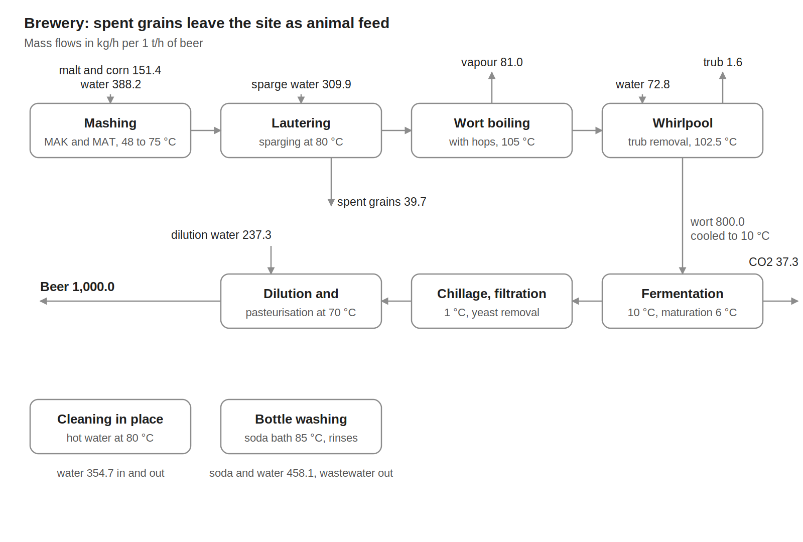
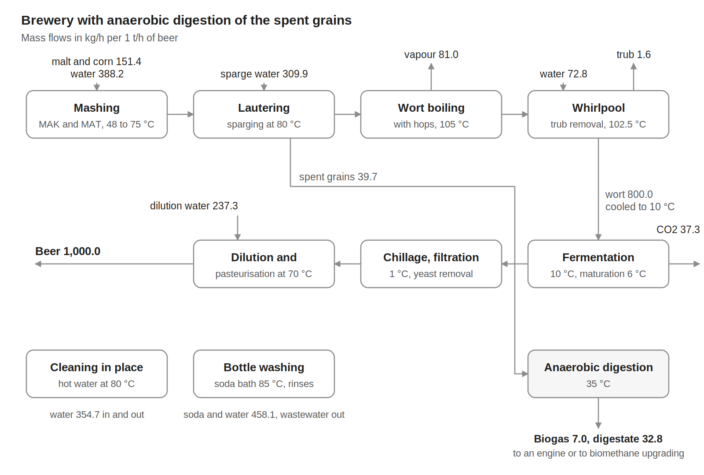

# Beer production {.unnumbered}



## Description

The brewery converts malt, corn and water into bottled beer. The malt and the corn are mashed, the wort is separated from the spent grains, boiled with hops, cooled and fermented, and the beer is matured, chilled, filtered, diluted, pasteurised and filled into returnable bottles. The two variants of the model differ in the use of the spent grains, about 40 kg per tonne of beer: they leave the site as animal feed (V0) or are digested on site into biogas ([V1](#v1)).

Breweries need heat below 110 °C, for mashing, wort boiling, pasteurisation, cleaning and bottle washing, and a large refrigeration demand for wort cooling, fermentation, maturation and chillage.

The models give the material flows, the electricity and the heat streams of the process per 1 t/h of beer, after the brewery model simulated in DWSIM by Bhatnagar, Flórez-Orrego and Boztas (Bhatnagar, Flórez-Orrego et al., manuscript) and the process integration study of the same brewery by [Maréchal et al. (2013)](https://doi.org/10.1533/9780857097255.5.820), with sector benchmarks for the electricity of breweries. The utilities that supply the heat, the refrigeration and the cooling are not part of the models. This page documents the base variant, V0, and then the digestion of the spent grains.

| Variant | Use of the spent grains | Heat streams | Min. hot utility | Min. cold utility |
|:--|:--|--:|--:|--:|
| V0 | Animal feed | 27 | 67.8 kW | 59.8 kW |
| [V1](#v1) | Biogas | 29 | 72.9 kW | 59.8 kW |

: Variants of the model, per 1 t/h of beer. {.striped}

## Key figures

Minimum utility requirements of variant V0 on its own, from its heat streams.



### Flows



## Model

Throughout this page, names written like `CAPACITY` are variables of the model: hover one for its definition, click it to go to its row in the [variables](#variables) table. @fig-brewery-v0 shows the process of variant V0, with the mass flows per 1 t/h of beer.

{#fig-brewery-v0 .lightbox width=100%}

### Process

**Mashing.** Malt is mixed with water in the mash tun (MAT), and malt and corn in the mash cooker (MAK): per tonne of beer, 139.9 kg of malt, `MALT_flow`, 11.5 kg of corn and 388.2 kg of water. The water, heated to 51.5 and 54.5 °C (C1, C2), brings both mashes to 48 °C; they are heated to 65 °C (C3), combined and heated to 75 °C (C4), while enzymes convert the starch into sugars.

**Lautering.** The mash is filtered with sparge water heated to 80 °C (C5), and the spent grains, 39.7 kg per tonne of beer, are separated from the wort.

**Wort boiling.** The wort is heated to 105 °C (C6) and boiled with hops for about one hour, and 10 % of it evaporates (C7). The vapour condenses at 100 °C (H1) and its condensate is cooled to 25 °C (H2).

**Whirlpool and wort cooling.** Make-up water heated to 80 °C is added (C8) and the trub, 0.2 % of the wort, is removed. The wort leaves at 102.5 °C and is cooled to 10 °C (H3), the largest hot stream of the plant.

**Fermentation, maturation and chillage.** The wort ferments at 10 °C for 14 days, and the heat of fermentation, 37.14 kJ per litre of wort, is removed (H4); the CO~2~ produced leaves the process. The beer is cooled to 6 °C (H5) and matured for 10 days (H6), then cooled to 1 °C (H7) and held so that the yeast settles (H8), and filtered.

**Dilution and pasteurisation.** The concentrated beer is warmed to 15 °C (C10) and diluted with water at 15 °C; the beer is heated to 70 °C (C11), held, and cooled to 5 °C (H9) for storage and filling, `BEER_flow`.

**Cleaning and bottle washing.** Water heated to 80 °C cleans the tanks and is not recovered (C9). The returnable bottles pass through a pre-rinse bath kept at 60 °C, a soda bath at 85 °C and a final rinse with fresh water (C12 to C16, H10); the final-rinse water is reused in the pre-rinse, and the water leaving the pre-rinse at 40 °C is cooled to 20 °C and sent to wastewater treatment (H11).

**Electricity.** The process takes `ELEC_process`, 59.4 kWh per tonne of beer: 21.7 kWh for packaging, 8.7 kWh for compressed air, 6.5 kWh for the brewhouse, 5.2 kWh for lighting and 17.3 kWh for other uses. These values split the midpoint of the benchmark for large breweries, 7.5 to 11.5 kWh per hectolitre of beer ([IFC, 2007](https://www.ifc.org/content/dam/ifc/doc/2000/2007-breweries-ehs-guidelines-en.pdf)), with the shares of a survey of breweries ([Galitsky et al., 2003](https://escholarship.org/uc/item/17r6j759)). The refrigeration compressors, 30.3 kWh/t, and the boiler house, 4.3 kWh/t, belong to the utilities and are not included.

### Modelling choices

**Reference flow.** Every flow and heat load is given per 1 t/h of beer, about 9.9 hl/h, and scales with `CAPACITY`, so a heat load in kW is also a specific energy in kWh per tonne of beer. The reference plant produces 68.7 t/h of beer over 8,760 hours per year, 601,685 t of beer per year. The material flows close at 1,972.4 kg/h in and out; the hops are not quantified in the source and are neglected.

**Heat streams.** The heat streams are those of the stream table and figures of Maréchal et al. (2013), divided by the 68.7 t/h of beer of the plant. Three corrections are made to the source: the beer is pasteurised at 70 °C, as in its text, instead of the 80 °C of its stream table; the load of the whirlpool make-up water is recomputed from its flow, which the source load does not match; and the warming of the concentrated beer is scaled to its flow after the release of CO~2~. Phase changes, and the heat released at constant temperature in fermentation, maturation and chillage, have a span of 0.1 K; small streams over the same temperature range are lumped together.

**Temperature differences.** All the streams use a minimum temperature difference contribution of 5 K, except the boiling of the wort and the condensation of its vapour, with 2 K.

**Utilities and boundary.** The steam, the hot water, the glycol-water loop, the ammonia refrigeration plant and the cooling water are not part of the model, and fermentation, maturation and chilling appear as hot streams at the beer temperature; only the electricity of the process itself is a connector. In the OSMOSE model, the heat streams are grouped by section into eleven units, from Mashing to Chillage, and the material flows and the electricity into the unit Plant_boundary, all at the scale `CAPACITY`. The JSON description gathers them into one unit, so that its targets are those of the whole plant. The model has no cost data.

## Variables



## Unit and connectors



## Heat integration

The cold streams need 267.2 kW and the hot streams release 259.2 kW per 1 t/h of beer. With the temperature difference contributions of the streams, heat recovery can cover 199.4 kW, so the process needs at least 67.8 kW of hot utility and 59.8 kW of cold utility, 51.6 kW of it as refrigeration below ambient temperature. The pinch is at 20 °C shifted, 25 °C on the hot streams and 15 °C on the cold streams, set by the fresh water that enters at 15 °C. The grand composite curve also comes close to zero at 98 °C shifted, between the boiling of the wort and the condensation of its vapour.

Most of the cold utility is refrigeration, for fermentation, maturation and chillage at 1 to 10 °C, while large flows of fresh water are heated from 15 to 80 °C. This makes breweries good candidates for heat pumps that recover the heat rejected by the refrigeration. The vapour of the wort boiling, which condenses at 100 °C, can heat the boiling at 105 °C only if its temperature is raised, for instance by vapour recompression.

### Heat streams



### Composite curves



### Grand composite curve



## Variants

### V1: anaerobic digestion of the spent grains {#v1}

The spent grains, 39.7 kg per tonne of beer at 75 °C, are cooled to 35 °C (H12) and fed to a mesophilic digester held at 35 °C (C17). It produces 7.0 kg of biogas with 55 vol % methane per tonne of beer, `BIOGAS_flow`, and 32.8 kg of digestate. The digester raises the minimum hot utility to 72.9 kW per 1 t/h of beer, and its feeding, mixing and gas handling add 1.2 kWh of electricity per tonne of beer.

The methane of the biogas, 29.6 kW on a lower heating value basis, is used by one of two utility units of the model: a cogeneration engine, which yields 8.9 kW of electricity, 9.2 kW of heat in its flue gas from 470 to 90 °C and 6.2 kW in its cooling water from 87 to 80 °C, or a membrane unit that upgrades it to biomethane for the gas grid with 1.1 kW of electricity. Select the unit in the overview to see its flows and heat streams.

{#fig-brewery-v1 .lightbox width=100%}



## Supplementary material

For each variant: the OSMOSE (Lua) implementation of the model, its description in the Task XXIV JSON format, the case study with its process data for mass and heat integration, the data workbook of the case study and the block flow diagram.

| Variant | Model | Case study and data |
|:--|:--|:--|
| V0, spent grains as animal feed | [Brewery_V0_ET.lua](Osmoses/Brewery_V0_ET.lua), [Brewery_V0.json](JSON/Brewery_V0.json) | [Case study](Documents/Brewery_V0_Case_Study_rs_qt.docx), [data workbook](Documents/Brewery_V0_rs_qt.xlsx), [diagram](Figures/brewery_V0_flowsheet.png) |
| V1, biogas | [Brewery_V1_ET.lua](Osmoses/Brewery_V1_ET.lua), [Brewery_V1.json](JSON/Brewery_V1.json) | [Case study](Documents/BreweryBiog_V1_Case_Study_rs_qt.docx), [data workbook](Documents/BreweryBiog_V1_rs_qt.xlsx), [diagram](Figures/brewerybiog_V1_flowsheet.png) |

## References


