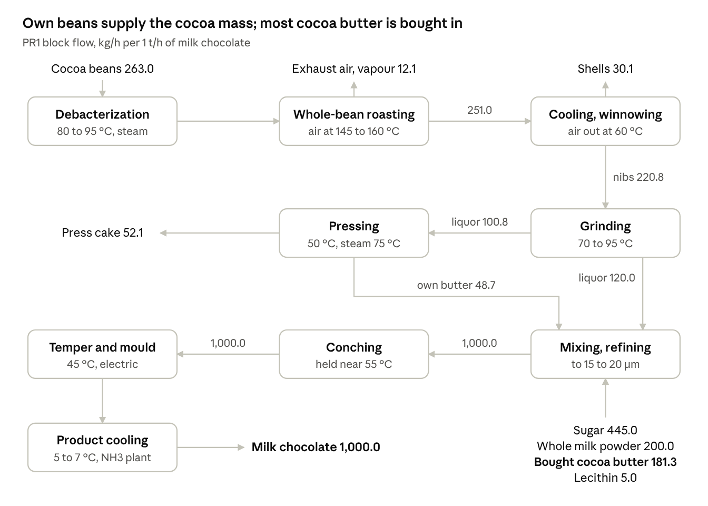

# Milk chocolate production {.unnumbered}



## Description

The plant converts whole fermented cocoa beans into milk chocolate (route PR1). The beans are debacterized, roasted whole with hot air, cooled and winnowed to separate the shells from the nibs, and the nibs are ground into cocoa liquor. Part of the liquor is pressed into cocoa butter and press cake. The liquor, the cocoa butter, sugar and milk powder are mixed, refined, conched, tempered, moulded and cooled. Most of the cocoa butter of the recipe is bought in; the beans of the plant supply the cocoa mass.

Chocolate making needs mostly low temperature heat, below 170 °C, and a large refrigeration demand to cool the moulded chocolate to 5 to 7 °C. This makes it a good candidate for heat pumps, as assessed for the Swiss chocolate industry by [Bhadbhade et al. (2024)](https://doi.org/10.1016/j.jclepro.2024.142323), whose sector data the model is based on.

The model gives the material flows, the electricity and the 45 heat streams of the process per 1 t/h of milk chocolate. The utilities that supply the heat, the refrigeration and the cooling are not part of the model.

## Key figures

Minimum utility requirements of the unit on its own, from its heat streams.



### Flows



## Model

Throughout this page, names written like `choco_prod` are variables of the model: hover one for its definition, click it to go to its row in the [variables](#variables) table. @fig-chocolate shows the process, with the mass flows per 1 t/h of chocolate.

{#fig-chocolate .lightbox width=100%}

### Process

**Recipe.** The milk chocolate is 12 % cocoa mass, 23 % cocoa butter, 44.5 % sugar, 20 % whole milk powder and 0.5 % lecithin. Per tonne of chocolate, the plant takes 263 kg of cocoa beans (`beans_in_r`), 445 kg of sugar (`sugar_in_r`), 200 kg of whole milk powder (`milkpowder_in_r`), 5 kg of lecithin (`lecithin_in_r`) and 181.3 kg of purchased cocoa butter (`butter_in_r`). It delivers the chocolate, 30.1 kg of cocoa shells (`shells_out_r`), 12.1 kg of water vapour in the roaster exhaust (`vapour_out_r`) and 52.1 kg of press cake (`presscake_out_r`). The flows close at 1,094.3 kg in and out.

**Debacterization and roasting.** The raw beans are debacterized at 80 to 95 °C with steam at 160 to 180 °C (C5). They are then roasted whole at about 100 °C in three hot-air zones, with the air heated to 145, 155 and 160 °C (C1 to C3); the moisture of the beans falls from 6.5 % to 2 %, and the exhaust air leaves at up to 110 °C (H1 to H3).

**Winnowing, grinding and pressing.** The roasted beans are cooled with air, broken and winnowed; the shells are 12 % of the roasted beans. The nibs are ground into cocoa liquor at 70 to 95 °C, with the heat of the mill removed by cooling water. Part of the liquor is pressed at 50 °C into cocoa butter and press cake with 11 % fat (C10, C11, H4, H5).

**Mixing, refining and conching.** The liquor, the cocoa butter, the sugar and the milk powder are mixed and roll-refined to 15 to 20 µm in a steam-jacketed mixer, which provides the drying duty (C4). The mass is conched in four lines, heated at the start (C12 to C15) and then cooled (H7 to H10), and held near 55 °C.

**Tempering, moulding and cooling.** The chocolate is tempered in nine storage tanks at 42 to 51 °C (C16 to C24) and moulded on two lines at 30 to 55 °C (C25 to C34). It is then cooled to 5 to 7 °C in cooling tunnels and cold rooms supplied with chilled water at 5/11 °C (H11).

**Site services.** A warm-water network at 55 °C keeps the chocolate molten in tracing circuits (C9), the largest heat demand of the plant. Cleaning in place uses caustic and acid solutions and rinse water (C6 to C8). The air compressors release heat that can be recovered between 70 and 16 °C (H6).

**Electricity.** The process takes `E_total`, 883 kWh per tonne of chocolate: the air compressors (`E_aircomp_r`), the conche drives (`E_conche_r`), the grinder drives (`E_grinder_r`) and the other drives, fans, lighting and packaging (`E_other_r`). For comparison, the Swiss sector uses about 1,833 kWh of final energy per tonne of chocolate, 59 % of it electricity, including its utilities.

### Modelling choices

**Reference flow.** Every flow and heat load is given per 1 t/h of milk chocolate and scales with `choco_prod`, so a heat load in kW is also a specific energy in kWh per tonne. The category 1 reference plant of the sector study, 1,000 t/y over 3,600 operating hours per year, is 0.278 t/h.

**Heat streams.** The heat streams are the Swiss chocolate sector stream loads of Bhadbhade et al. (2024), divided by the 200,000 t/y of chocolate of the sector, without the nibs roasting and infrared drying streams. The refrigeration plant of the sector data is replaced by the production cooling demand, H11: 337.5 kW from 11 to 5 °C, from the heat rejected by the refrigeration (427.2 kWh/t) and a cooling COP of 3.76 measured at a Swiss chocolate factory. The loads are averaged over the operating hours, and the batch steps (conching, cleaning in place) are given by their average load. Streams with a span of 0.1 or 1 K are near-isothermal duties: cleaning baths, drying, tempering tanks and moulding steps.

**Temperature differences.** All the streams use a minimum temperature difference contribution, `dtmin`, of 5 K, for a global ΔT~min~ of 10 K.

**Utilities and boundary.** The utilities that supply the heat, the refrigeration and the cooling water are not part of the model; only the electricity of the process itself is. The roasting air, the steam and the rinse water are given for information (`roast_air_r`, `steam_drying_r`, `steam_debact_r`, `cip_water_r`), but not as connectors. The model has no cost data.

## Variables



## Unit and connectors



## Heat integration

The cold streams need 645.2 kW and the hot streams release 815.8 kW per 1 t/h of chocolate. With a ΔT~min~ of 10 K, heat recovery can cover 292.0 kW, so the process needs at least 353.2 kW of hot utility and 523.8 kW of cold utility. The pinch is at 37 °C shifted, 42 °C on the hot streams and 32 °C on the cold streams. Of the cold utility, 337.5 kW are refrigeration below 11 °C, the production cooling, and 186.3 kW are cooling above ambient temperature.

All the heat demand is below 170 °C, and about half of it, the tracing network, the tempering tanks and the moulding, is below 60 °C. With the large refrigeration demand, this makes the process well suited to heat pumps that upgrade the heat rejected by the refrigeration.

### Heat streams



### Composite curves



### Grand composite curve



## Supplementary material

| File | Content |
|:--|:--|
| [Chocolate_PR1_ET.lua](Osmoses/Chocolate_PR1_ET.lua) | OSMOSE (Lua) implementation of the model |
| [Chocolate.json](JSON/Chocolate.json) | Model description in the Task XXIV JSON format |
| [chocolate.md](Rmarkdowns/chocolate.md) | Process data of route PR1: material flows, electricity, heat streams and reference targets |
| [ChocolatePR1.png](Figures/ChocolatePR1.png) | Block flow diagram of route PR1 |
| [PR1casestudyChocolate.docx](Documents/PR1casestudyChocolate.docx) | Case study of route PR1 for students, with the process data for mass and heat integration |

## References


