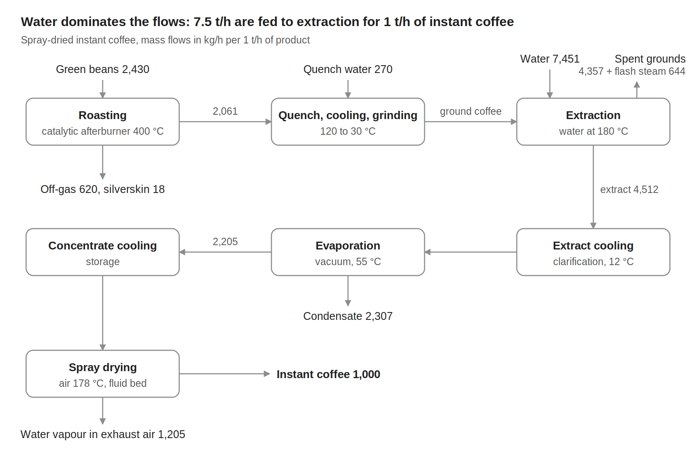
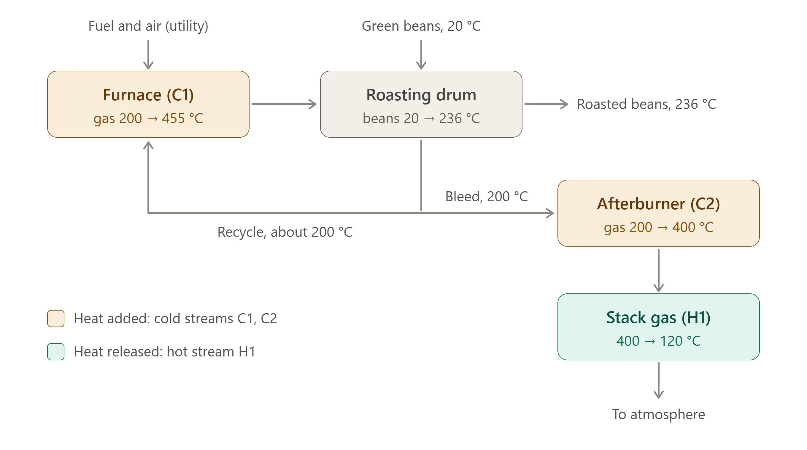

# Instant coffee production {.unnumbered}



## Description

The plant converts green coffee beans into spray-dried instant coffee. The beans are roasted, cooled and ground; the soluble solids are extracted with hot water, the extract is clarified and concentrated by vacuum evaporation, and the concentrate is spray dried in hot air. Water dominates the flows: 7.5 t/h of water are fed to the extraction for 1 t/h of instant coffee, and most of it has to be evaporated again or leaves with the spent grounds.

The heat demand of the plant spans a wide range of temperatures: the roaster furnace and the afterburner need heat up to 455 °C, the extraction water is heated to 180 °C, and the evaporator and the spray dryer need large amounts of heat below 180 °C. The reference plant, 5,000 t/y of instant coffee, is the one assessed by [Mitraki et al. (2026)](https://doi.org/10.66506/ed.52) for the energy transition of the instant coffee industry.

The model gives the material flows, the electricity and the 16 heat streams of the process per 1 t/h of instant coffee. The utilities that supply the heat, the refrigeration and the cooling are not part of the model.

## Key figures

Minimum utility requirements of the unit on its own, from its heat streams.



### Flows



## Model

Throughout this page, names written like `coffee_prod` are variables of the model: hover one for its definition, click it to go to its row in the [variables](#variables) table. @fig-coffee shows the process, with the mass flows per 1 t/h of instant coffee, and @fig-coffee-roaster the gas loop of the roaster.

{#fig-coffee .lightbox width=100%}

### Process

**Roasting.** The green beans, `beans_in_r`, 2.43 t per t of instant coffee with 10 % moisture, are roasted in batch drum roasters with gas recirculation. The gas is heated from 200 to 455 °C in the furnace (C1) and enters the roasting chamber, where the beans reach 236 °C, a medium roast. A bleed of the gas is heated to 400 °C in a catalytic afterburner (C2), which oxidizes the volatile organic compounds and the CO, and the stack gas is cooled from 400 to 120 °C (H1). The silverskin, `silverskin_out_r`, is separated in a cyclone, and the off-gas, `offgas_out_r`, carries the water vapour, the CO~2~ and the volatiles from the beans. The furnace and the afterburner are direct-fired: their burners, fuel and combustion air belong to the utility system.

{#fig-coffee-roaster .lightbox width=80%}

**Quench, cooling and grinding.** The roasted beans are quenched with water, `quench_water_in_r`, to 120 °C, cooled with air to 30 °C (H2) and ground.

**Extraction.** The ground coffee is extracted in a battery of percolation columns with water, `extraction_water_in_r`, heated from 20 to 180 °C (C3). The extract, with 21.5 % solids, leaves at 110 °C. The spent grounds, with 79 % moisture, are discharged at 180 °C into an atmospheric cyclone, where part of their water flashes to steam, `flash_steam_out_r` (H4); the grounds are then cooled to 40 °C (H5) and leave as `grounds_out_r`. The extraction yield is 48 % of the dry roasted coffee.

**Clarification and evaporation.** The extract is cooled from 110 to 12 °C (H3), clarified by centrifugation and stored. It is then preheated to 55 °C (C4) and concentrated to 44 % solids in a single-effect vacuum evaporator, which boils the extract at 55 °C (C5); the vapour condenses at about 50 °C (H6) and leaves as condensate, `condensate_out_r`. The concentrate is cooled to 12 °C for storage (H7).

**Spray drying.** The concentrate is preheated to 39 °C (C6) and atomized in a spray tower with ambient air heated to 178 °C (C7); a fluid bed at the bottom of the tower uses dehumidified air heated from 15 to 96 °C (C8). The exhaust air leaves at 96 °C through a cyclone (H8), with the water evaporated from the concentrate, `dryer_vapour_out_r`, and the powder, `coffee_out_r`, has 3 % moisture.

**Electricity.** The process takes `E_total`, 756 kWh per tonne of instant coffee: the electric motors of the roaster fans, grinders, pumps, vacuum pumps, dryer fans and conveyors (`E_motors_r`), of which 33 kWh for grinding (`E_grinding_r`), and the lighting (`E_lighting_r`).

### Modelling choices

**Reference flow.** Every flow and heat load is given per 1 t/h of instant coffee and scales with `coffee_prod`, so a heat load in kW is also a specific energy in kWh per tonne. The reference plant, 5,000 t/y over 8,000 operating hours per year, is 0.625 t/h. The flows close at 10,151.3 kg in and out, within the rounding of the data.

**Heat streams.** The heat loads are averaged over the operating hours, and the batch roasting and the extraction cycles are given by their average load. The roaster furnace (C1) and the afterburner (C2) are direct-fired duties, given as the heating of the process gas; the gas leaving the roasting chamber is taken at a mean 200 °C, although it rises during the roast. Streams with a span of 1 K are phase changes at nearly constant temperature: the evaporator, its vapour condenser and the flash steam. The extract and the concentrate are cooled to 12 °C, below ambient temperature (H3, H7), so the last part of their cooling needs refrigeration unless a cold stream takes it up.

**Temperature differences.** All the streams use a minimum temperature difference contribution, `dtmin`, of 5 K, for a global ΔT~min~ of 10 K.

**Utilities and boundary.** The burners and their fuel, the boilers and steam, the refrigeration plant, the cooling water and the dehumidification of the fluid-bed air are not part of the model; only the electricity of the process itself is. The air of the spray dryer and of the fluid bed is given for information (`dryer_air_r`, `fluidbed_air_r`, `exhaust_air_r`), but not as connectors. The model has no cost data.

## Variables



## Unit and connectors



## Heat integration

The cold streams need 6,230.2 kW and the hot streams release 4,028.2 kW per 1 t/h of instant coffee. With a ΔT~min~ of 10 K, heat recovery can cover 2,681.3 kW, so the process needs at least 3,548.9 kW of hot utility, 171.9 kW of it above 400 °C for the roaster furnace, and 1,346.9 kW of cold utility, 50.4 kW of it below ambient temperature. The pinch is at 45 °C shifted, 50 °C on the hot streams and 40 °C on the cold streams.

The evaporator boils the extract at 55 °C while its own vapour condenses at 50 °C: this pair sets the pinch, and its latent heat, about 1.5 MW per t/h, cannot be recovered by heat exchange alone. Only mechanical vapour recompression, a heat pump or a multiple-effect evaporator can recycle it. Without any heat recovery, supplying the cold streams with natural-gas burners for C1 and C2 and an 85 % efficient steam boiler for the others would take about 7,137 kWh of natural gas per tonne of instant coffee.

### Heat streams



### Composite curves



### Grand composite curve



## Supplementary material

| File | Content |
|:--|:--|
| [Coffee_SD_ET.lua](Osmoses/Coffee_SD_ET.lua) | OSMOSE (Lua) implementation of the model |
| [Coffee.json](JSON/Coffee.json) | Model description in the Task XXIV JSON format |
| [coffee_SD_flowsheet.png](Figures/coffee_SD_flowsheet.png) | Block flow diagram of the spray-dried route |
| [coffee_roaster_gas_loop_c1_c2_h1.png](Figures/coffee_roaster_gas_loop_c1_c2_h1.png) | Gas loop of the roaster, with the streams C1, C2 and H1 |
| [Instant_Coffee_SD_Case_Study_rs_qt.docx](Documents/Instant_Coffee_SD_Case_Study_rs_qt.docx) | Case study of the spray-dried route, with the process data for mass and heat integration |

## References


