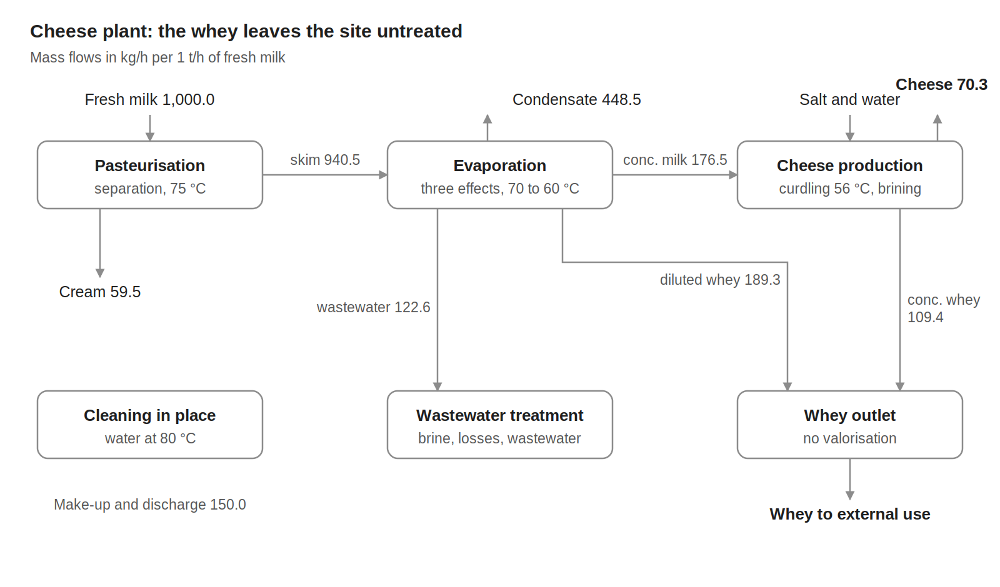
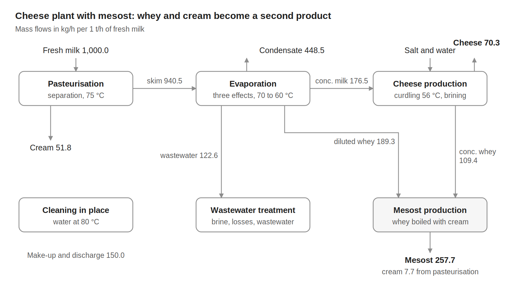
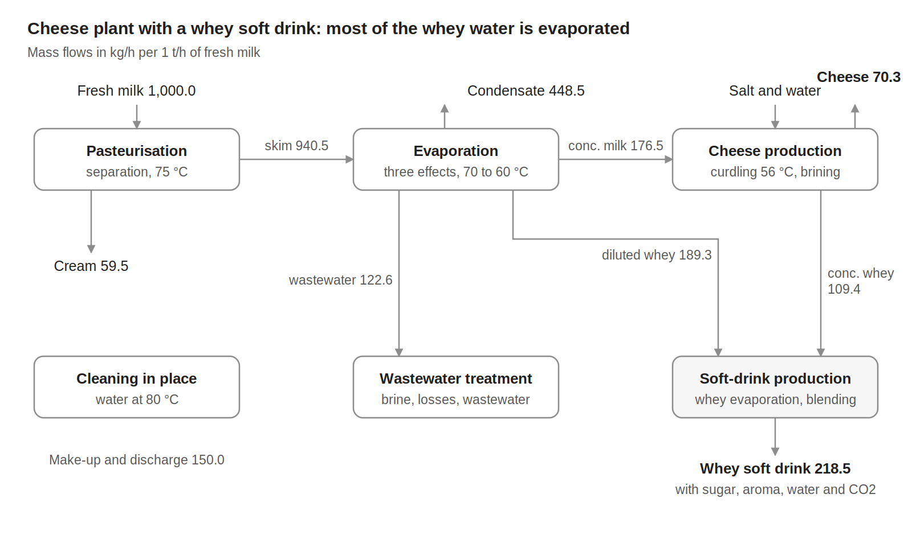
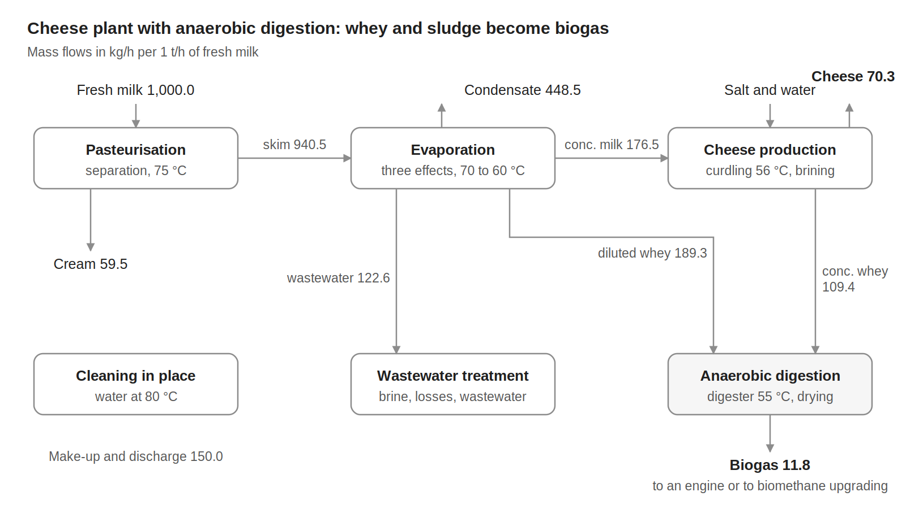

# Cheese dairy {.unnumbered}



## Description

The plant receives fresh milk and produces cream and cheese. The milk is pasteurised and skimmed, the skimmed milk is concentrated in a three-effect evaporator, and the concentrated milk is curdled and brined into cheese; cleaning in place and a wastewater treatment complete the site. About 300 kg of whey per tonne of milk is left over, and the four variants of the model differ in its use: it leaves the site (V0), is boiled down into mesost, a Scandinavian brown whey cheese ([V1](#v1)), is turned into a carbonated whey soft drink ([V2](#v2)), or is digested into biogas ([V3](#v3)).

Dairies need heat mostly below 100 °C, for pasteurisation, evaporation and cleaning, and refrigeration to keep the milk and the products cold. The evaporator dominates the heat balance and sets the pinch.

The models give the material flows, the electricity and the heat streams of the process per 1 t/h of fresh milk. The stream data come from the DWSIM dairy model of Bhatnagar, Flórez-Orrego, Boztas and Dardor and from [Dardor, Flórez-Orrego et al. (2024)](https://doi.org/10.1016/j.energy.2024.132182), and the process electricity from the energy use of European dairies reported by [Ramírez et al. (2006)](https://doi.org/10.1016/j.energy.2005.10.014). The utilities that supply the heat, the refrigeration and the cooling are not part of the models. This page documents the base variant, V0, and then the other variants.

| Variant | Use of the whey | Heat streams | Min. hot utility | Min. cold utility |
|:--|:--|--:|--:|--:|
| V0 | Leaves the site | 21 | 146.5 kW | 127.7 kW |
| [V1](#v1) | Mesost | 28 | 182.5 kW | 131.4 kW |
| [V2](#v2) | Whey soft drink | 30 | 236.0 kW | 213.1 kW |
| [V3](#v3) | Biogas | 27 | 146.2 kW | 117.0 kW |

: Variants of the model, per 1 t/h of fresh milk. {.striped}

## Key figures

Minimum utility requirements of variant V0 on its own, from its heat streams.



### Flows



## Model

Throughout this page, names written like `CAPACITY` are variables of the model: hover one for its definition, click it to go to its row in the [variables](#variables) table. @fig-dairy-v0 shows the process of variant V0, with the mass flows per 1 t/h of fresh milk.

{#fig-dairy-v0 .lightbox width=100%}

### Process

**Reception and pasteurisation.** The raw milk, `FRESH_MILK_flow`, arrives at 6 °C and is cooled to 4 °C and stored (H1). It is heated to 75 °C with regenerative heat exchange (C1); the cream is separated by centrifugation at about 60 °C, `CREAM_flow`, 59.5 kg per tonne of milk, and the pasteurised skimmed milk is cooled back to 4 °C (H2).

**Evaporation.** The skimmed milk, 940.5 kg per tonne of milk, is preheated to 70 °C (C2) and concentrated in three effects boiling at about 70, 65 and 60 °C (C3 to C5). Steam heats the first effect; the vapour of each effect heats the next one (H3, H4), and the vapour of the last effect is condensed (H5). The condensate, 448.5 kg per tonne of milk, is cooled to 25 °C (H6) and the concentrated milk to 4 °C (H7). A diluted whey stream and a wastewater stream are also separated.

**Cheese making.** The concentrated milk, 176.5 kg per tonne of milk, is heated to 56 °C (C6) and cultures are added; the curd and the whey are separated, and the curd is cooled to 16 °C (H8) and brined with salt and water at about 13 °C (C7, H9). The plant delivers 70.3 kg of cheese per tonne of milk, `CHEESE_flow`, and 298.6 kg of whey: the diluted whey of the evaporation at 4 °C and the whey of cheese making at 56 °C.

**Cleaning in place and wastewater.** Water is heated to 80 °C (C8, C9), circulated through the equipment and returned at 75 °C (H10); about 70 % is reused after cooling to 60 °C (H11), and the rest is cooled to 30 °C and discharged (H12). The brine, the evaporator wastewater and the product losses are treated, and a sludge is separated.

**Electricity.** The process takes `ELEC_process`, 7.05 kWh per tonne of milk: 5.37 kWh for the electric drives (separator, pumps, agitators, curd handling and cleaning pumps) and 1.68 kWh for compressed air. These values are derived from the energy use of Dutch cheese dairies, 4.3 GJ of primary energy per tonne of cheese, with electricity taken as 40 % of it, the share of the sector (Ramírez et al., 2006). The refrigeration compressors, about 6.4 kWh per tonne of milk in those dairies, belong to the utilities and are not included.

### Modelling choices

**Reference flow.** Every flow and heat load is given per 1 t/h of fresh milk and scales with `CAPACITY`, so a heat load in kW is also a specific energy in kWh per tonne of milk. The reference plant processes 28.8 t/h of fresh milk, about 28 m³/h, over 8,760 hours per year. The material flows close at 1,187.3 kg/h in and out.

**Heat streams.** The stream temperatures, heat loads and mass flows come from the DWSIM dairy model of Bhatnagar, Flórez-Orrego, Boztas and Dardor and from Dardor, Flórez-Orrego et al. (2024), divided by the 28.8 t/h of milk of the reference plant. The evaporator is described effect by effect. Streams that change phase at constant temperature have a span of 0.1 K, and very small mixing streams of the source model are lumped together.

**Temperature differences.** Each stream has its own minimum temperature difference contribution: 5 K for liquid streams and 2 K for the boiling and condensing streams of the evaporator, where the vapour of an effect condenses only 4 to 5 K above the next one.

**Utilities and boundary.** The steam, the hot water, the refrigeration, the cooling towers and the cooling water are not part of the model, and refrigeration demands appear as hot streams at the product temperature; only the electricity of the process itself is a connector. In the OSMOSE model, the heat streams are grouped by section into the units Pasteurisation, Evaporation, Cheese and CIP, and the material flows and the electricity into the unit Plant_boundary, all at the scale `CAPACITY`. The JSON description gathers them into one unit, so that its targets are those of the whole plant. The model has no cost data.

## Variables



## Unit and connectors



## Heat integration

The cold streams need 436.3 kW and the hot streams release 417.5 kW per 1 t/h of fresh milk. With the temperature difference contributions of the streams, heat recovery can cover 289.8 kW, so the process needs at least 146.5 kW of hot utility and 127.7 kW of cold utility, 14.1 kW of it as refrigeration below ambient temperature. The pinch is at 67.3 °C shifted, in the evaporator, between the boiling of the first effect and the condensation of its vapour.

The multiple-effect evaporator already reuses the heat of its vapours, and its first effect alone needs 122.0 kW just above the pinch, most of the minimum hot utility. Vapour recompression and heat pumps that lift heat across the pinch are the usual means of reducing the steam demand of such plants.

### Heat streams



### Composite curves



### Grand composite curve



## Variants

The variants keep the cheese line of V0 and add a unit that processes the whey. Each one is a model of its own, with its case study; its overview gives the key figures, the flows, the heat streams and the composite curves.

### V1: cheese and mesost {#v1}

The diluted whey and the whey of cheese making, 298.6 kg per tonne of milk, are mixed at about 21 °C, heated with 7.7 kg of cream to boiling at 100.6 °C, and part of their water is evaporated; the vapour is sent to the cleaning system. The mesost base, `MESOST_flow`, 257.7 kg per tonne of milk, is cooled to 8 °C; it is an intermediate product before the final concentration. The boiling of the whey raises the minimum hot utility to 182.5 kW per 1 t/h of milk.

{#fig-dairy-v1 .lightbox width=100%}



### V2: cheese and whey soft drink {#v2}

The whey is heated to 97 °C and most of its water is evaporated at about 100 °C; the concentrate is cooled to 45 °C, blended with sugar, aroma and water, cooled to 10 °C and carbonated with CO~2~. The plant delivers 218.5 kg of drink per tonne of milk, `WHEY_SOFT_DRINK_flow`. The evaporation of the whey, 165 kW at about 100 °C, raises the minimum hot utility to 236.0 kW per 1 t/h of milk. The whey evaporator keeps the temperature difference contribution of 8 K of the source model.

{#fig-dairy-v2 .lightbox width=100%}



### V3: cheese and biogas from whey {#v3}

The whey and the sludge of the wastewater treatment are heated to 55 °C and digested under thermophilic conditions, producing 11.8 kg of biogas with 55 vol % methane per tonne of milk, `BIOGAS_flow`. The digestate is heated to 95 °C and dried with steam into a liquid fertiliser and a dried digestate. The minimum hot utility of the process, 146.2 kW per 1 t/h of milk, stays close to that of V0: the drying vapour, condensed at about 100 °C, returns most of the heat that the digestion and the drying take, and the cold utility falls to 117.0 kW.

The biogas, 50.9 kW on a lower heating value basis, is used by one of two utility units of the model: a cogeneration engine, which yields 20.4 kW of electricity, 11.2 kW of heat in its flue gas from 450 to 150 °C and 12.7 kW in its cooling water from 90 to 40 °C, or a membrane unit that upgrades it to biomethane for the gas grid with 2.8 kW of electricity. Select the unit in the overview to see its flows and heat streams.

{#fig-dairy-v3 .lightbox width=100%}



## Supplementary material

For each variant: the OSMOSE (Lua) implementation of the model, its description in the Task XXIV JSON format, the case study with its process data for mass and heat integration, the data workbook of the case study and the block flow diagram.

| Variant | Model | Case study and data |
|:--|:--|:--|
| V0, whey to external use | [Dairy_V0_ET.lua](Osmoses/Dairy_V0_ET.lua), [Dairy_V0.json](JSON/Dairy_V0.json) | [Case study](Documents/DairyCheese_V0_Case_Study_rs_qt.docx), [data workbook](Documents/DairyCheese_V0_rs_qt.xlsx), [diagram](Figures/dairycheese_V0_flowsheet.png) |
| V1, mesost | [Dairy_V1_ET.lua](Osmoses/Dairy_V1_ET.lua), [Dairy_V1.json](JSON/Dairy_V1.json) | [Case study](Documents/DairyMesost_V1_Case_Study_rs_qt.docx), [data workbook](Documents/DairyMesost_V1_rs_qt.xlsx), [diagram](Figures/dairyMesost_V1_flowsheet.png) |
| V2, whey soft drink | [Dairy_V2_ET.lua](Osmoses/Dairy_V2_ET.lua), [Dairy_V2.json](JSON/Dairy_V2.json) | [Case study](Documents/DairyRivella_V2_Case_Study_rs_qt.docx), [data workbook](Documents/DairyRivella_V2_rs_qt.xlsx), [diagram](Figures/dairyrivella_V2_flowsheet.png) |
| V3, biogas | [Dairy_V3_ET.lua](Osmoses/Dairy_V3_ET.lua), [Dairy_V3.json](JSON/Dairy_V3.json) | [Case study](Documents/DairyBiog_V3_Case_Study_rs_qt.docx), [data workbook](Documents/DairyBiog_V3_rs_qt.xlsx), [diagram](Figures/dairybiog_V3_flowsheet.png) |

## References


