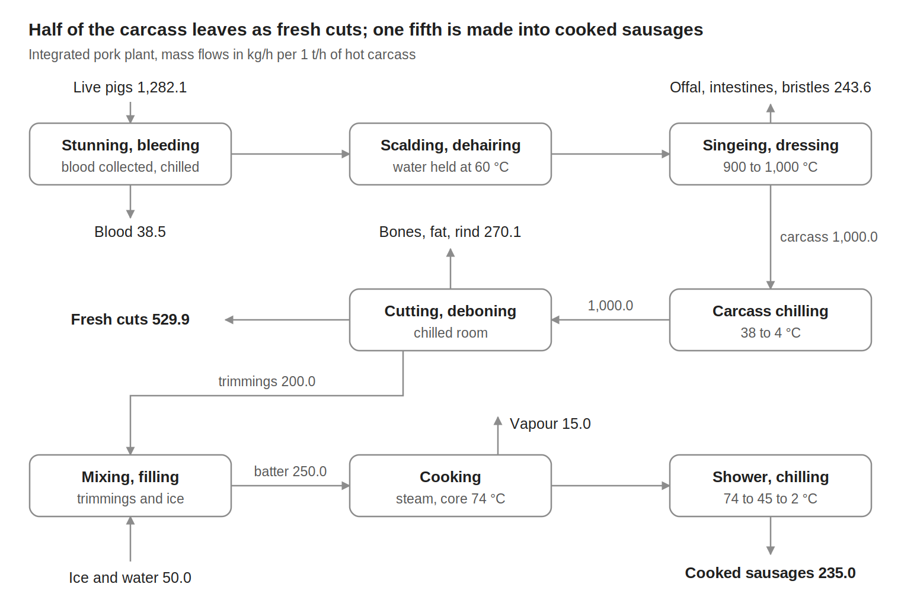

# Integrated pork plant {.unnumbered}



## Description

The plant slaughters pigs, chills and cuts the carcasses, sells most of the meat as fresh cuts and turns the trimmings into cooked sausages of the cervelat type. Combining a slaughter line with meat processing on one site is typical of large plants, as in the Swedish plant studied by [Fritzson and Berntsson (2006)](https://doi.org/10.1016/j.jfoodeng.2005.06.007). Half of the carcass leaves as fresh cuts and one fifth is made into cooked sausages.

Meat plants need heat mostly as hot water for cleaning and sterilising, and at modest temperatures for scalding and cooking, while their largest energy demand is refrigeration: the carcasses, the products and the rooms where the meat is cut and stored must be kept cold. Singeing, at 900 to 1,000 °C, is the only high-temperature duty.

The model gives the material flows, the electricity and the 14 heat streams of the process per 1 t/h of hot carcass. The utilities that supply the steam, the hot water, the refrigeration and the cooling are not part of the model.

## Key figures

Minimum utility requirements of the unit on its own, from its heat streams.



### Flows



## Model

Throughout this page, names written like `carcass_prod` are variables of the model: hover one for its definition, click it to go to its row in the [variables](#variables) table. @fig-meat shows the process, with the mass flows per 1 t/h of hot carcass.

{#fig-meat .lightbox width=100%}

### Process

**Slaughter line.** The live pigs, `pigs_in_r`, 1,282.1 kg per t of carcass, are stunned and bled; the blood, `blood_out_r`, 3 % of the live weight, is collected and chilled to about 5 °C (H4). The carcasses are scalded in water at 58 to 65 °C for 3 to 6 min, with the tank held near 60 °C by steam (C2), and dehaired. They are singed in a direct-fired oven at 900 to 1,000 °C (C1) to remove the residual hair, then polished, eviscerated and split; the offal, intestines and bristles leave as `offal_out_r`.

**Chilling and cutting.** The carcasses are chilled from about 38 to 4 °C (H5): EU rules require pig meat to reach at most 7 °C before cutting or transport. They are cut and deboned in chilled rooms held at 2 °C (H7). The boneless meat is the carcass divided by 1.37; the bones, fat and rind leave as `bones_out_r`, and the boneless meat is sold as fresh cuts, `cuts_out_r`, except the trimmings, 20 % of the carcass mass, which go to the sausage line.

**Sausage line.** The trimmings are mixed with ice and water, `ice_in_r`, salt and spices into a batter and filled into casings. The sausages are cooked with direct steam injection at 113 °C to a core temperature of 74 °C (C6), losing 6 % of their mass as vapour, `vapour_out_r`; the oven exhaust air is cooled from 70 to 35 °C (H1). They are showered to about 45 °C (H2), chilled to 2 °C (H6) and leave as `sausages_out_r`.

**Storage.** The products are stored in chilled rooms at about 2 °C (H7) and in freezer rooms at about −25 °C (H8).

**Water networks.** Three networks, all fed with mains water at 11 °C, serve the plant: hot water at 82 °C for knife sterilisers and disinfection (C3), warm water at 55 °C for cleaning (C4), and tap water at 40 °C for hand washing and personnel facilities (C5). The cleaning water, C4, is the largest heat demand of the plant.

**Electricity.** The process takes `E_total`, 192 kWh per tonne of carcass: the slaughter line (`E_slaughter_r`), the cutting and deboning (`E_cutting_r`) and the sausage line (`E_sausage_r`). The air compressors, about 18 kWh/t (`E_aircomp_r`), are included in these rows; their recoverable heat is stream H3. For comparison, a large Swedish slaughter and meat-processing plant of the reference size used about 490 kWh of electricity and 420 kWh of fuel per tonne of carcass, including the refrigeration, the boilers and the comfort heating.

### Modelling choices

**Reference flow.** Every flow and heat load is given per 1 t/h of hot carcass, 11.05 pigs/h at the Swiss average carcass of 90.5 kg, and scales with `carcass_prod`, so a heat load in kW is also a specific energy in kWh per tonne of carcass. The reference plant, 700,000 pigs/y over 6,300 operating hours per year, is 10.06 t/h. The flows close at 1,332.1 kg in and out.

**Heat streams.** The heat loads are averaged over the operating hours, and the batch steps (cooking, cleaning) are given by their average load. The singeing oven (C1) is a direct-fired duty: its burner and flue gas belong to the utility system. Streams with a span of 1 K are near-isothermal duties: the scalding tank, the steam injection for cooking, and the room air held at a set temperature. The cold demand of the blood, the carcasses and the rooms (H4, H5, H7, H8), 200 kWh/t, is the electricity of the cooling systems times a seasonal COP of 2.0, with 3 % for the freezers; the chilled rooms take the remainder after the carcass chilling.

**Temperature differences.** All the streams use a minimum temperature difference contribution, `dtmin`, of 5 K, for a global ΔT~min~ of 10 K.

**Utilities and boundary.** The steam, the hot-water generation, the refrigeration and the cooling are not part of the model; only the electricity of the process itself is. The water networks are given for information (`hot_water_r`, `warm_water_r`, `tap_water_r`): they are mains water discharged as wastewater, and are not connectors. The model has no cost data.

## Variables



## Unit and connectors



## Heat integration

The cold streams need 308.0 kW and the hot streams release 252.2 kW per 1 t/h of carcass. With a ΔT~min~ of 10 K, heat recovery can cover only 70.4 kW, so the process needs at least 237.6 kW of hot utility, 28.0 kW of it above 900 °C for the singeing, and 181.8 kW of cold utility, 6.0 kW of it at the freezer level. The pinch is at 16 °C shifted, 21 °C on the hot streams and 11 °C on the cold streams.

Because the water networks start from mains water at 11 °C, they absorb the warm heat sources: the oven exhaust, the sausage shower and the compressors. All of the minimum cold utility therefore lies below ambient temperature and must be supplied by refrigeration. This makes the plant a good candidate for heat pumps that recover the heat rejected by the refrigeration to heat the water networks.

### Heat streams



### Composite curves



### Grand composite curve



## Supplementary material

| File | Content |
|:--|:--|
| [Meat_plant_ET.lua](Osmoses/Meat_plant_ET.lua) | OSMOSE (Lua) implementation of the model |
| [Meat.json](JSON/Meat.json) | Model description in the Task XXIV JSON format |
| [Meat_plant.md](Rmarkdowns/Meat_plant.md) | Process data of the integrated pork plant: material flows, electricity, heat streams and reference targets |
| [meat_flowsheet.png](Figures/meat_flowsheet.png) | Block flow diagram of the integrated pork plant |
| [Meat_Plant_Case_Study_rs_qt.docx](Documents/Meat_Plant_Case_Study_rs_qt.docx) | Case study of the integrated pork plant for students, with the process data for mass and heat integration |

## References


