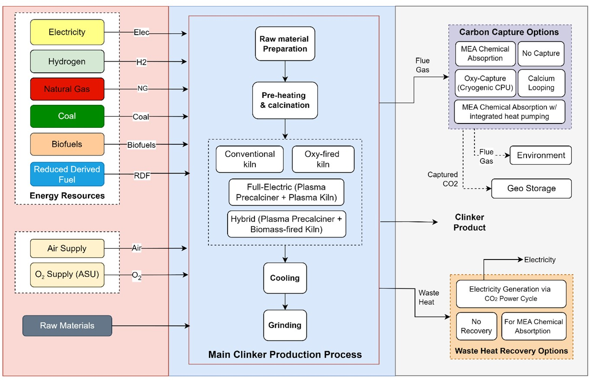

# Cement production {.unnumbered}



## Description

Cement is made by burning a raw meal of limestone, clay and minor additives into clinker, and grinding the clinker with gypsum and supplementary cementitious materials such as fly ash, slag, limestone or calcined clay. The clinker is burned at about 1450 °C, and the decomposition of the limestone (CaCO~3~ → CaO + CO~2~) releases process CO~2~ whatever the fuel. Replacing part of the clinker with other materials is therefore one of the main levers to cut the emissions of cement.

The model represents a cement plant with a dry short kiln. The raw meal is ground and dried in a double rotator raw mill, heated in a cyclone pre-heater, calcined in a pre-calciner and sintered in a rotary kiln; a grate cooler cools the clinker and heats the combustion air. Six cement mills produce CEM I, CEM II/B-W, CEM II/B-S, CEM II/B-LL, CEM III/A and LC3 (limestone calcined clay cement). Two optional units complete it: a flash calciner, which produces calcined clay for LC3, and an air separation unit, which supplies oxygen when the plant has CO~2~ capture.

The model has 19 units, from five OSMOSE files: the raw mill, the four units of the kiln train, a feed unit and a mill unit for each of the six cements, the clay calciner and the air separation unit. The fuel of the kiln is not part of this model: the heat it needs is the hot utility of the kiln train.

The model is the base plant of the decarbonisation study of Salman et al. (manuscript for Applied Energy), which assesses 32 configurations of a representative Belgian plant producing 5,000 t/day of clinker: fuel switching (coal, natural gas, biomass, biomethane, refuse-derived fuel and hydrogen), partial and full electrification with plasma heating, four CO~2~ capture routes (MEA absorption, MEA with heat pumps, oxy-fuel capture with a CO~2~ purification unit, and calcium looping) and waste heat recovery (@fig-cement-superstructure). In the study, the reference plant burns coal and needs 3.48 GJ of fuel and 0.4 GJ of electricity per tonne of clinker, with direct emissions of 0.8 t of CO~2~ per tonne of clinker.

## Key figures

Minimum utility requirements of the unit on its own, from its heat streams. The scale factor *f* multiplies every duty and flow on this page, as the optimization does with the unit's size. Choose the unit to show with the selector.



### Flows



## Model

Throughout this page, names written like `KILNCC_CLINKER_MASSF` are variables of the model: hover one for its definition, click it to go to its row in the [variables](#variables) table. The same holds for the symbols in the equations and for underlined values in the tables. The equations below are generated from the formulas of the model's JSON description, and each is tagged with the name of the variable it defines. @fig-cement-superstructure shows the main clinker production process and the options of the study that can be combined with it.

{#fig-cement-superstructure .lightbox width=100%}

### Process

**Clinker demand.** The kiln is sized from the cement it supplies. Each of the six cements is produced at `MILL_CEM_MASSF`, 62,500 kg/h, if its flag (`add_CEM1` to `add_CEM6`) is 1, and needs its share of clinker, from 0.95 kg per kg of CEM I (`KILNCC_CLINKER_RATIO1`) to 0.45 kg per kg of CEM III (`KILNCC_CLINKER_RATIO5`). With all six cements, the kiln produces 245,000 kg/h of clinker, `KILNCC_CLINKER_MASSF`, and every flow and heat load of the kiln train is proportional to it.

**Raw mill.** The double rotator mill, `RAWMILL_DOUBLEROTATOR`, grinds limestone, clay, sand, granulated blast furnace slag and sludge into raw meal, `DOUBLEROTATOR_RAWMEAL_MASSF`, with `DR_TOTAL_POWER` of electricity. The raw meal is dried and heated from 18 to 99.5 °C in five steps (`DR_Q1_LOAD` to `DR_Q5_LOAD`), and part of its moisture evaporates (`DR_Q6_LOAD`).

**Pre-heater and pre-calciner.** In the four-stage cyclone pre-heater, `KILNPH_DRY`, the raw meal, `RAWMEAL_MASSF`, is heated to about 730 °C by the gas rising from the pre-calciner (`PHT_HT1_LOAD`, `PHT32_LOAD`, `PH_HT2_LOAD`). In the pre-calciner, `KILNPC_DRY`, it is heated to 900 °C (`PC_PREHEAT_LOAD`) and most of the limestone is calcined, which takes `KILN_PC_REAC_LOAD`, the largest heat demand of the plant. The calcination releases the CO~2~ of the pre-calciner, `PC_flue_gas_MASSF`. The tertiary air from the clinker cooler and the hot kiln gas are cooled to 425 °C in the pre-calciner (`KILN_DRY_TAIR_LOAD`, `KILN_KILNGAS_LOAD`).

**Rotary kiln.** In the kiln, `KILN_DRY`, the pre-calcined raw meal, `KILN_RAWMEAL_MASSF`, is heated from 910 °C to 1444 °C and sintered into clinker. The solids are described by eight temperature nodes (`KILN_QEX1_LOAD` to `KILN_QEX8_LOAD`), each with its own minimum temperature difference contribution (`KILN_DTS_VAR1` to `KILN_DTS_VAR8`) for the heat exchange between the gas and the solids. The secondary air from the cooler is cooled from 1078 to 425 °C (`KILN_DRY_SAIR_LOAD`). The kiln gas, `KILN_KG11_MASSF`, carries `KILN_IMPACT` of CO~2~, and the kiln takes `KILN_DRY_TOTAL_POWER` of electricity.

**Clinker cooler.** In the grate cooler, `KILNCC_DRY`, the clinker is cooled from 1444 °C by air, which is heated to 1078 °C as secondary air for the kiln (`KILNCC_SAIR_LOAD`) and to 247 °C as grate exhaust air (`KILNCC_G_LOAD`). The clinker heat above 300 °C, `KILNCC_Q1_LOAD_kiln`, stays in the default heat cascade; the heat between 300 and 65 °C, `KILNCC_Q1_LOAD_HREC`, is available for heat recovery, as in the BAT reference document of 2013.

**Cement mills.** Each cement has a feed unit, which mixes its constituents, and a mill unit, which grinds the mix with electricity, water and grinding aid. The constituents are ratios of the mill production, `MILL_CEMPROD1_MASSF` to `MILL_CEMPROD6_MASSF`; 20 % of the gypsum is scrap gypsum (`GLOBAL_SCRAP_GYPSUM_RATIO`). The grinding energy of each cement is the sum of a coarse step, from the feed size to 750 µm, and a fine step, from 750 µm to the product size (`MILL_SP_CEMPROD1_POWER_COARSE`, `MILL_SP_CEMPROD1_POWER_FINE`), from the Bond work index of the cement (`Wi_CEMI`, `Wi_CEMII`, `Wi_CEMIII`). It is about 0.05 kWh per kg, so each mill takes 20 to 23 MW at its reference production of 450,000 kg/h.

**Clay calciner.** The flash calciner, `CLAY_CALICINER`, dries and heats `CCa_CLAY_IN_sz` of kaolinite clay to 800 °C (`CCa_HEATING_LOAD`), where the kaolinite is dehydroxylated into metakaolin (`CCa_CALC_HEAT`). The calcined clay, `CCa_CALC_CLAY_OUT`, is cooled to 98.75 °C (`CCa_CALC_COOLING`) and goes to the LC3 mill. Flash calcination gives a more reactive product than a rotary kiln, which can replace 30 to 40 % of the clinker instead of 15 to 25 %. The unit is in the problem only when `add_ClayCal` is 1.

**Air separation unit.** The cryogenic air separation unit, `ASU`, produces oxygen at 95 % purity, `ASU_O2_OUT`, with `RATIO_ASU_TOTAL_POWER_IN` of electricity per kg of oxygen. Its adsorption beds, which remove the CO~2~, water and heavy hydrocarbons from the air, are regenerated with low pressure steam at up to 200 °C (`TSA_REGEN_LP_HEAT_IN`). The unit is in the problem only when the plant has CO~2~ capture with a CO~2~ purification unit or calcium looping, `add_ASU`.

**Investment cost.** The kiln train costs `CAPEX_ref` for the 1 Mt/y reference plant, `ref_plant`, scaled linearly with the clinker production, updated from 2018 to 2024 with the CEPCI and annualized over `Number_year_ws` years at `Interest_rate_ws`, to give `Cinv2_KILN_DRY`. It is 10 % lower with plasma torches (`CAPEX_adjustment`). The clay calciner and the air separation unit are scaled from a reference size with an exponent of 0.6, to give `Cinv2_ClayCal` and `Cinv2`. The raw mill and the cement mills also have cost correlations (`Cinv2_DOUBLEROT`, `Cinv2_prod1` to `Cinv2_prod6`), but their units do not use them.



### Modelling choices

**Plant size.** The values are those of the Lua files. With all six cements, the kiln produces 245,000 kg/h of clinker, more than the 5,000 t/day (208,333 kg/h) reference plant of the study; to model that plant, reduce `MILL_CEM_MASSF` or the cement flags. The Lua file describes the pre-heater as four-stage, where the study's reference plant has five stages.

**Reference sizes.** Each unit has its own reference size, and the optimization scales each one with its size factor. The reference sizes are not consistent with each other: the raw mill produces 792,000 kg/h of raw meal for the 362,600 kg/h the kiln needs, and each cement mill grinds 450,000 kg/h of cement where the kiln is sized for 62,500 kg/h of each. The clinker ratios of the kiln and of the mills also differ for some cements, for instance 0.67 and 0.70 kg per kg for CEM II/B-W.

**Global parameters.** Some parameters of the Lua files are set by the cement cluster they belong to, and are not defined in them. They are given here as placeholders: `annual_cap_cement` is 1, so the investments are in EUR per year; there are no plasma torches (`CEM_addPlasma`) and no CO~2~ capture (`add_CCSCement`, `add_CPU`, `add_CaL`), so the air separation unit is not used. Two conditional formulas of the Lua files, for `CAPEX_adjustment` and `add_ASU`, are written as equivalent arithmetic. The electricity costs of the Lua files are not included, since they need an electricity price that is not defined and the units do not use them.

**Heat cascades.** All the heat streams are in the default heat cascade, except the clinker cooling between 300 and 65 °C, in `HREC`. The minimum temperature difference contributions follow the Lua files: very small for the pre-calciner, the raw mill and the cooling air, which exchange heat directly with the gas; 162 to 286 °C for the kiln nodes; 50 °C for the clinker cooling; and 200 °C for the clay calciner.

**Known issues.** The moisture evaporated in the raw mill, `DR_MOIST_MASSF`, is on the CO~2~ layer of the flue gas, `CO2_in_flue_gas`. The cooling of the tertiary air and of the kiln gas is calculated with the raw meal flow and heat capacity. Kiln nodes 8 and 7 have negative heat loads, so they release heat, although the Lua file describes them as endothermic. The CEM II/B-S mill uses the work index of CEM II, and the LC3 mill the specific grinding energy of CEM I. The total cooling air of the cooler, `KILNCC_TOTAIR_MASSF`, adds the clinker flow to the air ratio instead of multiplying them; it is not used.

**Boundary.** The fuel of the kiln and its combustion, the CO~2~ capture, the supply of the raw materials and the shipping of the cement are outside the model.

## Variables



## Units and connectors



## Heat integration

The kiln train needs heat at kiln temperatures. On their own, the pre-heater needs 134 MW, the pre-calciner 132 MW and the kiln 39 MW, while the clinker cooler needs only 9.7 MW: the air it heats takes most of the clinker heat. Together, the four units of the kiln train need 184 MW, or 2.7 GJ per tonne of clinker, which the fuel of the kiln has to supply; they need no cold utility. This is the heat taken up by the materials; with the efficiency of the combustion and the losses of the kiln, the reference plant of the study needs 3.48 GJ of fuel per tonne of clinker. The 16 MW of clinker heat between 300 and 65 °C are available for heat recovery in the `HREC` cascade.

The raw mill needs 23 MW of heat below 100 °C to dry and heat the raw meal, which waste heat can supply, for instance the kiln exhaust gas. The clay calciner needs 24 MW at 800 °C for 100,000 kg/h of clay and can release 4 MW. The air separation unit needs 26 MW of low pressure steam at its reference size.

### Heat streams



### Composite curves



### Grand composite curve



## Supplementary material

| File | Content |
|:--|:--|
| [CM_SP_RAWMILL_DOUBLEROTATOR_Optim.lua](Osmoses/CM_SP_RAWMILL_DOUBLEROTATOR_Optim.lua) | OSMOSE (Lua) implementation of the raw mill |
| [CM_SP_DRYKILN_Optim.lua](Osmoses/CM_SP_DRYKILN_Optim.lua) | OSMOSE (Lua) implementation of the kiln train: pre-heater, pre-calciner, rotary kiln and clinker cooler |
| [CM_SP_MILL_Optim.lua](Osmoses/CM_SP_MILL_Optim.lua) | OSMOSE (Lua) implementation of the cement mills |
| [CM_SP_CLAY_CALCINATION_Optim.lua](Osmoses/CM_SP_CLAY_CALCINATION_Optim.lua) | OSMOSE (Lua) implementation of the clay calciner |
| [CM_SP_AIR_SEPARATION_Optim.lua](Osmoses/CM_SP_AIR_SEPARATION_Optim.lua) | OSMOSE (Lua) implementation of the air separation unit |
| [Cement.json](JSON/Cement.json) | Model description in the Task XXIV JSON format |
| [CementSuperstructure.jpg](Figures/CementSuperstructure.jpg) | Superstructure of the decarbonisation options of clinker production |

## References


