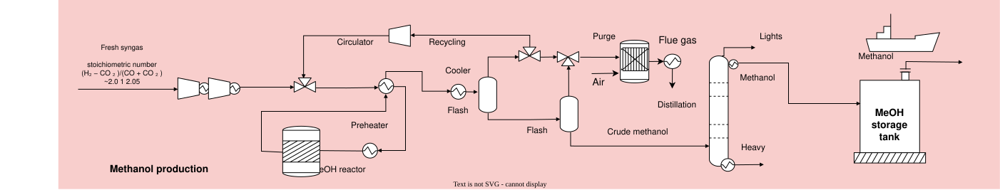

# Methanol synthesis from co-electrolysis syngas {.unnumbered}



## Description

The methanol synthesis process converts a syngas with a hydrogen-to-carbon ratio of 2:1 into methanol in an isothermal catalytic reactor. The syngas is produced by the CO~2~/H~2~O co-electrolysis model COSOECOiken7300Am2scrat21MEOH, so the unit is the methanol production step of a power-to-methanol chain. The model converts 5,726.79 kg/h of syngas into 4,302.79 kg/h of methanol; roughly 997 co-electrolysis units feed one methanol unit. The methanol synthesis and distillation section follows the one assessed by [Domingos et al. (2022)](https://doi.org/10.1016/j.compchemeng.2022.107810), where it is fed with syngas from black liquor gasification in a kraft pulp mill.

The unreacted gas is recycled to the reactor, and the purge is burned with pure oxygen in a flare, so the carbon it carries leaves as CO~2~ ready for capture. A distillation column separates the crude methanol into methanol, light gases and a bottoms stream of water and heavier alcohols, which goes to waste water treatment.

## Key figures

Minimum utility requirements of the unit on its own, from its heat streams.



### Flows



## Model

Throughout this page, names written like `massflow_syngas_in` are variables of the model: hover one for its definition, click it to go to its row in the [variables](#variables) table. @fig-meoh shows the process.

{#fig-meoh .lightbox width=100%}

### Process

**Synthesis loop.** The fresh syngas, `massflow_syngas_in`, is mixed with the recycle gas and heated in the feed/effluent exchanger from 72 °C to 175 °C (`hxmeoh1_Q`), against the reactor effluent cooling from 210 °C to 154 °C (`hxmeoh2_Q`). A preheater brings the feed to the reactor temperature of 210 °C (`meohrxpreh_Q`). The reactor is isothermal, and its heat of reaction, `meohreactor_Q`, is available at 210 °C. The recycle compressor of the loop, `E_comprecycl`, is the only electricity demand of the process.

**Flash separation.** The reactor effluent is cooled from 135 °C to 30 °C (`cooltoflash1_Q`), which condenses the crude methanol, and two flash separators split the liquid from the unreacted gas (`cooltoflash2_Q`). Most of the gas is recycled to the reactor; the rest is purged to avoid the build-up of inerts.

**Oxy-fired flare.** The purge is burned with pure oxygen, `massflow_O2_flare`. The radiative section of the flare is isothermal at 1000 °C (`fluecool1_Q`), and the flue gas is then cooled to 150 °C (`fluecool2_Q`) and to its condensation onset at 94 °C (`fluecool3_Q`). Below that, down to 30 °C, its water condenses (`fluecool4_Q`) and leaves as clean condensate, `massflow_H2O_out`, while the remaining gas is pure CO~2~, `massflow_CO2_out`.

**Distillation.** The crude methanol from the flashes is distilled in one column, with its reboiler at 100 °C (`reboilerheat_Q`) and its condenser at 13 °C (`condheat_Q`). The methanol product, `massflow_MeOH_out`, is warmed from 13 °C to 25 °C (`meohcool_Q`), and the bottoms, water carrying the higher alcohols, are cooled from 100 °C to 25 °C (`heavycool_Q`) and leave as `massflow_wastewater_out`.

**Waste water treatment.** The bottoms cannot be discharged directly, so the model sends them to a second unit, `WWTP_dummy_MeOHprod`, which discharges them as treated water. This unit is a placeholder: its specific electricity, `spec_work_WWTP`, and its 1:1 water recovery, `m3_per_kg_H2O`, are token values, not a design.

### Modelling choices

**Operating point.** The model is one operating point of the Aspen Plus simulation: every flow, temperature, heat load and electricity demand is a value taken from it, and the heat loads are absolute values for the 5,726.79 kg/h syngas feed. The unit `MeOHprodCOSOEC21` can be scaled linearly up to `Mult_MeOHprod` times this size. The only calculated variable is the condensate volumetric flow, `volflow_H2O_out`.

**Heat streams.** Every heater, cooler, reboiler, condenser and reactor of the simulation is one heat stream. The flare flue gas is split in segments at the end of the radiative section and at the condensation onset, so that the composite curves place the heat where it is released. The minimum temperature difference contribution of each stream depends on its phase: `dtmin_gas` for gases, `dtmin_liq` for liquids and `dtmin_2ph` for evaporating or condensing streams.

**Combustion heat.** The heat of the purge combustion, `fluecool1_Q`, is taken as available at 1000 °C, the temperature of the isothermal radiative section of the flare.

**Boundary.** The syngas production, the oxygen production and the conditioning of the CO~2~ are outside the model. The condensate and the treated bottoms are delivered to the water grid. The model has no cost data.

## Variables



## Unit and connectors



## Heat integration

The process needs no hot utility: the heat released by the reactor and the flare covers all its heating, including the 2,900 kW of the column reboiler at 100 °C. Its cold utility is 9,317 kW. Of this, the 2,918 kW of the column condenser must be removed at 13 °C, below the temperature of cooling water, and therefore needs chilled water or refrigeration.

### Heat streams



### Composite curves



### Grand composite curve



## Supplementary material

| File | Content |
|:--|:--|
| [MeOHprodCOSOEC2to1FlareIsothermalv4_ET.lua](Osmoses/MeOHprodCOSOEC2to1FlareIsothermalv4_ET.lua) | OSMOSE (Lua) implementation of the model |
| [MeOH.json](JSON/MeOH.json) | Model description in the Task XXIV JSON format |
| [MeOH.png](Figures/MeOH.png) | Process flow diagram, high-resolution image |
| [MeOH.drawio](Figures/MeOH.drawio) | Editable process flow diagram |
| [MeOHprodCOSOEC2to1FlareIsothermalv4.xlsx](mailto:daniel.florezorrego@epfl.ch,meire.ribeirodomingos@epfl.ch?subject=Access%20to%20the%20methanol%20synthesis%20model%20data) | Aspen Plus results from which the mass and energy balances are taken. Contact the model authors to access it. |

## References


