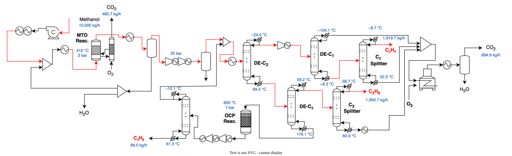

---
aliases:
  - /3-IndustrialProcesses/ChemicalSector/MethanolToOlefins/index.html
---

# Methanol-to-olefins {.unnumbered}



## Description

The methanol-to-olefins (MTO) process converts methanol into light olefins, mainly ethylene and propylene, in a fluidised-bed reactor with continuous catalyst regeneration. The model covers the reactor and the complete separation train, and produces polymer grade ethylene and propylene from 10,000 kg/h of methanol. It is the olefins production step of the thermochemical pathways for olefins production assessed by [Boztas et al. (2025)](https://doi.org/10.1016/j.renene.2025.124303).

The reactor effluent is quenched, compressed and separated by cryogenic distillation, and the C~4~ and heavier olefins are cracked to recover more light olefins. The non-valuable streams are burned with pure oxygen, so the plant releases its carbon as CO~2~ ready for capture.

## Key figures

Minimum utility requirements of the unit on its own, from its heat streams.



### Flows



## Model

Throughout this page, names written like `meoh_input` are variables of the model: hover one for its definition, click it to go to its row in the [variables](#variables) table. @fig-mto shows the process, with the condenser and reboiler temperature of each column.

{#fig-mto .lightbox width=100%}

### Process

**Reaction.** The methanol feed, `meoh_input`, is pumped to 3 bar (`e_mto_1`), preheated and vaporised at 94 °C (`mto_c1_ho`, `mto_c2_ho`). It is mixed with steam raised at 3 bar from recycled process water (`mto_c4_ho`, `mto_c5_ho`) and superheated to 310 °C (`mto_c3_ho`). The fluidised-bed reactor operates at 410 °C and 3 bar, and its net heat release, `mto_h22_ho`, is available at the bed temperature. The coke deposited on the catalyst is burned off in the regenerator with stoichiometric pure oxygen, `oxygen_regen`, which gives `CO2_regen`.

**Quench and compression.** The reactor effluent is cooled from 410 °C to 126 °C, then quenched to 25 °C, which condenses most of the water it carries (`mto_h2_ho_a` to `mto_h2_ho_d`). Part of this water is reused to raise the steam; the rest leaves as waste water, `WasteWater_output`. The gas is compressed to 8.7 bar and then to 25 bar (`e_mto_2`, `e_mto_3`), with an aftercooler after each stage (`mto_h3_ho`, `mto_h4_ho`). A three-phase flash separates the free water, `WasteWater_flash`, the CO~2~ is washed out, `CO2_wash`, and the gas is chilled to 10 °C (`mto_h5_ho`).

**Separation.** The deethaniser (DE-C~2~) splits the gas into a C~2~ and lighter cut and a C~3~ and heavier cut. The light cut is compressed to 33 bar (`e_mto_4`) and chilled to −20 °C (`mto_h9_ho_a`, `mto_h9_ho_b`). The demethaniser (DE-C~1~), with its condenser at −104 °C (`mto_h10_ho`), sends the hydrogen, methane and CO overhead as off-gas. The C~2~ splitter delivers ethylene at 99.93 mol%, `ethylene_output`, pumped to 80 bar for export (`e_mto_9`); its bottoms are ethane. The heavy cut goes to the depropaniser (DE-C~3~), whose distillate the C~3~ splitter separates into propylene at 99.91 mol%, `propylene_output`, and propane.

**Olefin cracking.** The C~4~ and heavier bottoms of the depropaniser are let down to 1 bar, vaporised and heated to 450 °C (`mpreheat_lat_ho`, `mpreheat_ho`), and cracked at 600 °C in the olefin cracking reactor (OCP, `mto_c12_ho`). The products are cooled, compressed to 8 bar in two stages (`e_mto_5`, `e_mto_6`) and separated in a column into butene, `butene_output`, and a light stream. The light stream is compressed back to 25 bar (`e_mto_7`, `e_mto_8`) and returned to the gas ahead of the CO~2~ wash.

**Oxy-combustion.** The demethaniser off-gas, the ethane and the propane are warmed to 25 °C (`mto_c18_ho`, `mto_c16_ho`, `mto_c17_ho`, `mto_c15_ho`) and burned with stoichiometric pure oxygen, `oxygen_combust`. The flue gas is cooled to its dew point of 88.1 °C (`mto_h19_ho`) and then to 25 °C, condensing its water (`mto_h23_ho_a` to `mto_h23_ho_c`); a flash separates the condensate, `H2O_inFlueGas`, from the CO~2~, `CO2_combust`.

### Modelling choices

**Operating point.** The model is one operating point of the Aspen Plus simulation: every flow, temperature, heat load and electricity demand is a value taken from it, and the unit `MTO` is not scaled (its capacity multiplier is fixed at 1). The only calculated variables are the totals that feed the connectors: `e_demand`, `Total_oxygen_inlet`, `CO2_inFlueGas` and `WasteWater_total`.

**Heat streams.** Every heater, cooler, reboiler, condenser and reactor of the simulation is one heat stream. Where condensation makes the heat release strongly non-linear with temperature, the stream is split in segments, so that the composite curves place the heat where it is released: the product quench in four (`mto_h2_ho_a` to `mto_h2_ho_d`), the demethaniser feed cooling in two (`mto_h9_ho_a`, `mto_h9_ho_b`) and the flue gas condensation in three (`mto_h23_ho_a` to `mto_h23_ho_c`). The minimum temperature difference contribution of each stream depends on its phase: `dtmin_gas` for gases, `dtmin_liq` for liquids and `dtmin_2ph` for evaporating or condensing streams.

**Combustion heat.** The reactor heat, `mto_h22_ho`, is available at the bed temperature of 410 °C. The heat of the coke combustion in the regenerator, `mto_h1_ho`, and of the oxy-combustion, `mto_h17_ho`, is taken as available at 1000 °C; the flue gases are then cooled to 25 °C (`mto_h18_ho`, `mto_h19_ho` and the condensation segments).

**Boundary.** The production of the oxygen and the conditioning of the CO~2~ are outside the model, and the model has no cost data.

## Variables



## Unit and connectors



## Heat integration

The process needs no hot utility: the heat released by the reactor, the combustions and the quench covers all its heating. Its cold utility is 9,388 kW, of which about 1.5 MW must be removed below 0 °C and therefore needs refrigeration, down to 178 kW at −104 °C for the demethaniser condenser.

### Heat streams



### Composite curves



### Grand composite curve



## Supplementary material

| File | Content |
|:--|:--|
| [MTO_olefinsProcess.lua](Osmoses/MTO_olefinsProcess.lua) | OSMOSE (Lua) implementation of the model |
| [MTO.json](JSON/MTO.json) | Model description in the Task XXIV JSON format |
| [MTO.png](Figures/MTO.png) | Process flow diagram, high-resolution image |
| [MTO.drawio](Figures/MTO.drawio) | Editable process flow diagram |
| [New_Biofins_MainProcess_Final.bkp](mailto:oktay.boztas@epfl.ch,meire.ribeirodomingos@epfl.ch,daniel.florezorrego@epfl.ch?subject=Access%20to%20the%20MTO%20Aspen%20Plus%20model) | Aspen Plus model from which the mass and energy balances are taken. Contact the model authors to access it. |

## References


